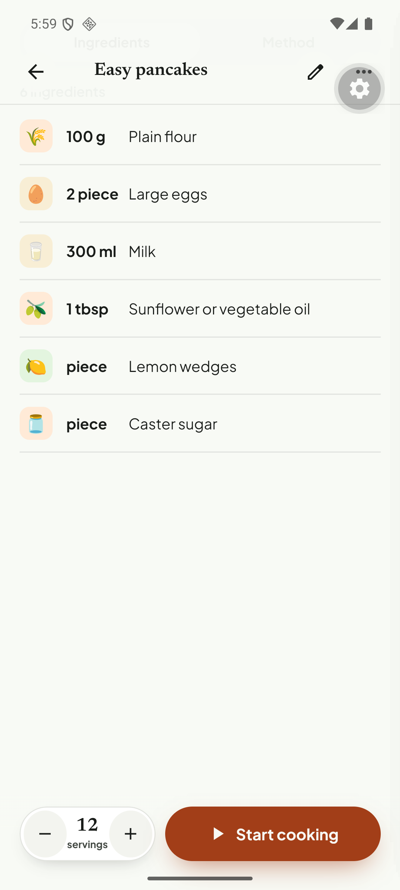

# Q01. Keep units and ranges when the model puts them in `quantity`

🔴 High · API (`apps/api`) · Findings **F15, F15b, F42, F44** · also touches mobile display

## Problem

Importing a page through the **fallback (page-text) path** stores ingredients with **no unit** and collapses ranges to their lower bound. The user sees "¼ Kosher salt", "2 Ripe avocados", "1 Fresh lime or lemon juice": teaspoon/tablespoon are gone, so the recipe cannot be cooked from the list. Count-like rows with no amount render as "**piece** Lemon wedges".

Source: `https://www.simplyrecipes.com/recipes/perfect_guacamole/` (blocked for plain fetch, so it goes through Apify; `structuredData: null`). The same bug does **not** appear for JSON-LD sites (BBC kept `200 g`, `1 tsp`) or YouTube (`250 g`, `1 clove`).

| Source text | Stored `quantity` / `unit` | Shown |
| --- | --- | --- |
| 1/4 teaspoon kosher salt | 0.25 / *(none)* | ¼ Kosher salt |
| 1 tablespoon fresh lime or lemon juice | 1 / *(none)* | 1 Fresh lime or lemon juice |
| **2 to 4 tablespoons** minced red onion | **2** / *(none)* | 2 Minced red onion |
| **1 to 2** serrano chilis | **1** | 1 Serrano or jalapeño chilis |
| 1 pinch black pepper | *(none)* + warning `Could not parse "Pinch"` | blank amount column |
| BBC: lemon wedges, to serve | null / `piece` | **piece** Lemon wedges |
| BBC: caster sugar, to serve | null / `piece` | **piece** Caster sugar |

## Evidence

DB check (`recipe_ingredients`, guacamole): `0.250 | | Kosher salt`, `1.000 | | Fresh lime or lemon juice`, `2.000 | | Minced red onion…`. The row's `rawExtraction` JSON still holds the model's correct `metric: {1.25 g}` / `imperial: {0.008 oz}`; the final `metricUnit` column is null.

## Root cause (verified in code)

1. **Extraction schema** (`modules/recipes/prompts/recipe-extraction-v1.ts`, ~l.139): `quantity` is a *string*, `unit` is a nullable string. On page-text input the model writes the whole phrase in `quantity` ("1/4 teaspoon", "2 to 4 tablespoons") and leaves `unit` null.
2. **`IngredientNormalizer.normalize`** (`modules/normalization/application/ingredient-normalizer.ts`): `parseQuantity(ingredient.quantity)` returns only the first number (`units.ts`: "2-3 → 2", and "2 to 4" is not a range pattern at all). The unit comes **only** from `ingredient.unit`; the unit text inside `quantity` is discarded.
3. **`reconcileMeasurements`** (`modules/normalization/domain/measurement-conversion.ts` ~l.410): `isCountUnit(null)` is `true`, so it returns `{ metric: asWritten, imperial: asWritten }` and throws away the model's own `metric`/`imperial` values. That is why `metricUnit` ends up null although the raw JSON had `g`.
4. **"piece" with no amount:** the model returns `unit: "piece"` for "to serve" ingredients (the prompt asks for no unit). The mobile detail row (`tortie/lib/fmt.ts` `fmtIngQty`: `q ? … : u || ''`) prints a bare unit when there is no amount. `displayUnit()` (hides `piece`) is only used for step hints and groceries, not for the detail/editor rows.

## Fix

**API**

1. Add `splitQuantityPhrase(raw)` in `normalization/domain/units.ts`. It returns `{ min, max | null, unit | null }` and recognises "1/4 teaspoon", "1½ cups", "2 to 4 tablespoons", "2–4", "2-4", "1 or 2", "about 3". Use `normalizeUnit` and the existing `UNIT_MAP` for the unit word. Keep `parseQuantity` for callers that only want the first number.
2. In `IngredientNormalizer.normalize`: when `ingredient.unit` is empty, take the unit from `splitQuantityPhrase(ingredient.quantity)`.
3. `reconcileMeasurements`: only treat "no unit" as a count when the model's `metric`/`imperial` also carry no measurable unit. If either is a real unit, use the existing "original unit not recognised" branch (cross-check, derive the other side).
4. **Ranges:** decide the storage (needs a small decision, see "Open question"). Recommended: new nullable column `quantityMax numeric(10,3)` on `recipe_ingredients` (+ contracts field), `quantity` stays the minimum. The mobile row shows "2–4 tbsp"; scaling multiplies both ends; shopping uses the max.
5. Normaliser: when `quantity` is null, **drop count units** (`piece`, `pieces`, `slice`) so "to serve" rows have no unit. Keep `Pinch` as a non-numeric amount label (see Q04).
6. Prompt: in `recipe-extraction-v1.ts` say "`quantity` is a number or a numeric range only; put the unit word in `unit`" and add two few-shot examples ("1/4 teaspoon salt", "2 to 4 tablespoons onion"). **Bump the prompt version** (it is stored in `recipes.promptVersion`).

**Mobile**

7. `fmtIngQty` (`tortie/lib/fmt.ts`) and the editor row: never print a bare count unit; render "2–4 tbsp" when `quantityMax` is present.

**Open question for the owner:** range storage. Option A `quantityMax` column (recommended); option B keep a display string `quantityText` and a numeric midpoint for scaling.

**Backfill (optional):** a one-off script can re-run steps 1–3 over `recipes.rawExtraction.ingredients[*].quantity` for existing rows, since the original strings are kept.

## Acceptance criteria

- Re-import `simplyrecipes.com/recipes/perfect_guacamole/`: kosher salt `0.25 tsp`, lime juice `1 tbsp`, onion `2–4 tbsp`, serrano `1–2`, cilantro `1–2 tbsp`; metric/imperial columns filled.
- BBC pancakes: "Lemon wedges" and "Caster sugar" show **no** unit word; "2 Large eggs" (no "piece").
- Imperial toggle still converts (`0.25 tsp` stays `¼ tsp`, volumes → fl oz).
- JSON-LD and YouTube imports unchanged.

## Tests

- `apps/api` vitest next to the code (`units.test.ts`, `ingredient-normalizer.test.ts`, `measurement-conversion.test.ts`): table tests for the phrases above, unit-null + model-metric present, count-unit with null quantity, Romanian/translated unit words still go through `ROMANIAN_UNIT_MAP`.
- Mobile jest: `fmtIngQty` with `u='piece', q=null`; range rendering.
- Manual: re-run the Simply Recipes import through the share intent (Apify key required).
