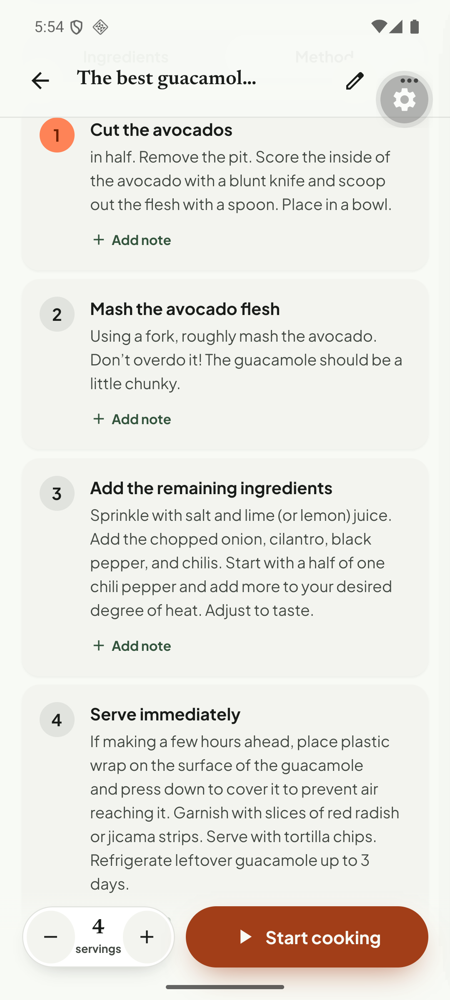

# Q02. Step order and step title/body split

🔴 High · API · Findings **F39, F69, F25, F29**

## Problem

1. **Wrong step order (BBC "Easy pancakes").** Step 1 is "*Rest the batter*, 30 min" and step 2 is "*Make the batter*". On the source page you mix the batter first and rest it afterwards ("Set aside for 30 mins to rest *if you have time, or start cooking straight away*"). Cook mode would run a 30-minute timer for a batter that does not exist yet. The Method tab even labels it **BEFORE YOU START**.
2. **Sentence split between title and body (Simply Recipes guacamole).** Step 1 is stored as title "Cut the avocados" + body "*in half.* Remove the pit. …" (lower-case start). The same text shows in Method and in cook mode.

## Evidence

DB (`recipe_steps`, pancakes): `1 | Rest the batter | 30 min`, `2 | Make the batter | …`, `3 | Prepare the pan`, `4 | Cook`, `5 | Serve`.

## Root cause

1. **Verified.** `RecipeNormalizer` (`modules/normalization/application/recipe-normalizer.ts` ~l.160) sorts steps with `ahead === true` before all others. The extraction prompt (`recipe-extraction-v1.ts` l.89) tells the model that `ahead` is for work before the cooking session "and put every ahead step before the session steps". The model flagged an **optional** rest ("if you have time") as `ahead: true`, and the normaliser then hoisted it above the step that creates the batter.
2. **Hypothesis (check `rawExtraction.steps[0]`).** The model returned `title: "Cut the avocados"` and `instruction: "in half. Remove the pit…"` (it moved words out of the sentence into the title). The mobile app then shows title + body as-is (`tortie/data/recipes.ts` `stepCopy` → `stripLeadingTitle`, which only strips a duplicated heading).

## Fix

1. **Order:** never reorder by `ahead` alone. Keep source order and only hoist a step when it is *independent of the others*, i.e. it does not reference ingredients that a previous step creates, **and** the text is not optional ("if you have time", "optional", "while", "meanwhile"). Simplest safe rule: hoist only when the step text contains a known pre-step pattern (soak, marinate, brine, overnight, take out of the fridge, preheat) **and** it comes before any step with a measuring/mixing verb. Otherwise keep `stepOrder` from the model, show the "BEFORE YOU START" chip on the original position.
2. Prompt (`recipe-extraction-v1.ts`): "A rest that is *optional* or comes *after* a mixing step is **not** `ahead`. Keep steps in the source order." Add the pancake example. Bump the prompt version.
3. **Title/body:** add a validation in `recipe-validator.ts`/`shapeExtractedStep`: if `instruction` starts with a lower-case letter and the title ends without punctuation, merge them (`title + ' ' + instruction`) and re-derive a short title (first clause up to the first verb phrase), or drop the title (`title: null`; the mobile `splitStep` already handles titleless steps). Add a warning code `STEP_TITLE_SPLIT`.
4. Prompt: "The step title is a label of 2–5 words. **Never** take words out of the instruction: the instruction must be a complete sentence that starts with a capital letter."

## Acceptance criteria

- BBC pancakes: Make the batter → Rest the batter → Prepare the pan → Cook → Serve. Rest keeps its 30-min timer and is **not** marked BEFORE YOU START.
- A genuine pre-step ("Soak the rice for 4 hours" at the top of the source) is still marked BEFORE YOU START and sits first.
- No stored instruction starts with a lower-case letter after normalisation. Guacamole step 1 reads "Cut the avocados" / "Cut the avocados in half. Remove the pit…" or a clean title + sentence.

## Tests

- `recipe-normalizer.test.ts`: fixtures for the pancake ordering (optional rest after mixing) and a real pre-step; assert the order.
- Validator test for the lower-case-start merge.
- Manual re-import of the two URLs (BBC pancakes via share intent; Simply Recipes needs Apify).
