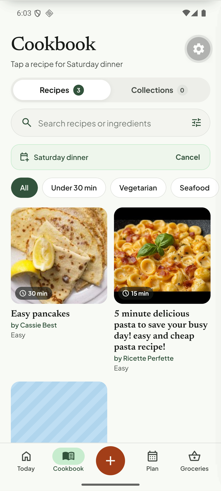

# Q03. Title casing and the "by Website" byline

🟠 Medium · API + mobile · Findings **F36, F19**

## Problem

1. **Every title is lower-cased after the first letter.** "5 Minute Delicious Pasta to Save Your Busy Day! Easy and Cheap Pasta Recipe!" is stored as `5 minute delicious pasta to save your busy day! easy and cheap pasta recipe!`. "The Best Guacamole Recipe" became "The best guacamole recipe". Proper nouns, brands and acronyms are lost ("Nonna's BBQ Ribs" → "Nonna's bbq ribs"). Titles that were already sentence-case (BBC "Easy pancakes") look fine, which is why this looked YouTube-specific.
2. **"by Website".** When the source has no author the UI prints a literal "by Website" on the detail page, the Today card and every Cookbook card.

## Evidence

## Root cause (verified)

1. `toSentenceCase()` (`apps/api/src/modules/normalization/domain/casing.ts`) does `lower.charAt(0).toUpperCase() + lower.slice(1)`. It is applied to the **recipe title** in `recipe-normalizer.ts` (`const title = toSentenceCase(extracted.title)`, ~l.203) and to ingredient names / step headings. It is the right call for ingredient names ("wholemeal pitta"), not for titles.
2. The byline falls back to a generic string when `recipeSources.metadata.author` is null (the source type is `GENERIC_WEB`, label "Website"). Check `tortie/data/recipes.ts` `toTRecipe` / the Cookbook card (`by {author ?? sourceLabel}`).

## Fix

1. Titles: stop forcing case. Keep the source casing; only trim, collapse whitespace, strip a trailing site suffix (" | Simply Recipes", " - BBC Good Food"). If the title is ALL CAPS (> 70 % upper), convert to Title Case. Keep `toSentenceCase` for ingredient names and step headings.
2. Strip the clickbait tail only on explicit patterns (emoji, "!!!"), not by case-folding. Do not rewrite the wording.
3. Mobile: when there is no author, show the **domain** ("bbcgoodfood.com") or hide the byline. Never print "Website"/"Video"/"Link" as a name. Same rule on Today and Cookbook cards.
4. Long titles: clamp card titles to 2 lines (`numberOfLines={2}`) so the grid keeps even heights.
5. Data fix for existing rows (optional): re-derive from `rawExtraction.title` / `recipe_sources.metadata.title`, which keep the original casing.

## Acceptance criteria

- The YouTube import title keeps its original casing. The BBC and Simply Recipes titles are unchanged from the source.
- "by Website" appears nowhere. No-author recipes show the domain or nothing.
- Cookbook cards never exceed 2 title lines.

## Tests

- `casing.test.ts`: titles with proper nouns, acronyms, ALL CAPS, trailing site suffix.
- Mobile jest for the byline helper (author present / absent / domain-only).
