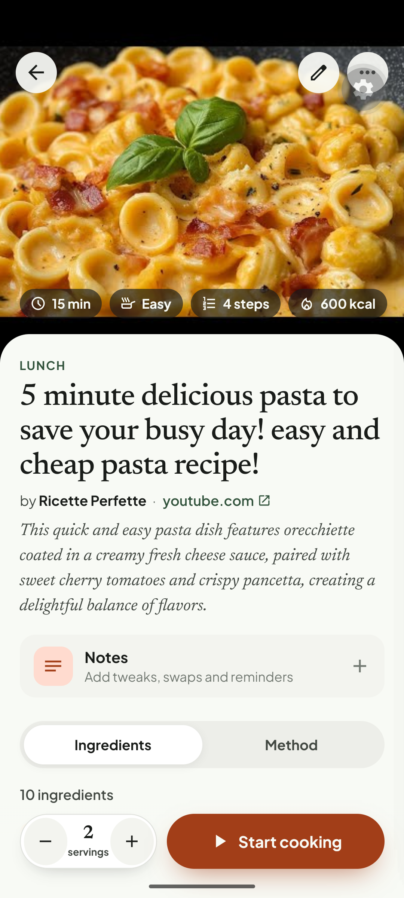

# Q04. Ingredient fidelity, groups, servings and validation noise

🟠 Medium · API · Findings **F37, F40, F41, F75, F17**

## Problem

1. **Specifics are lost** (YouTube): the description says *orecchiette, cherry tomatoes, pancetta, Robiola*; stored rows are "Pasta", "Tomatoes", "Bacon", "Fresh soft cheese (robiola)".
2. **Ingredient groups are flattened** (BBC chocolate cake has sponge / buttercream / shards): the list shows `Cocoa powder 2 tbsp` and `Cocoa powder 5 tbsp`, `Milk chocolate` 100 g and 25 g, `Butter` and `Unsalted butter`, with no headings. "A pinch of salt" is in the method but not in the list (pancakes, cake).
3. **Implausible servings / calories:** pancakes **12 servings, 61 kcal**; cake 14 servings, 523 kcal. Servings flow into Today ("Serves 12") and the plan.
4. **Clumsy inline conversions in step text:** `100g (3.53 oz) plain flour`, `300ml (10.14 fl oz)`, `1 tbsp (15 ml)`, `for 1 min (1 min)`, `Bake for 20 minutes (20 mins)`, `every 30 seconds (30 secs)`. False precision and duplicated durations.
5. **False validation warnings:** `STEP_INGREDIENT_MISMATCH` on steps that do have `ingredientRefs`; `Could not parse quantity "Pinch"`.

## Evidence

DB (cake): ingredients `Cocoa powder 2 tbsp`, `Cocoa powder 5 tbsp`, `Milk chocolate 100 g`, `Milk chocolate 25 g`, `Butter 200 g`, `Unsalted butter 200 g`; warnings on steps 3, 4, 11.

## Root cause

1. **Hypothesis:** the YouTube extractor summarises from the video captions and the model generalises. Check the evidence passed to the model (`extraction_evidence`): is the full description included?
2. **Verified:** `recipeIngredient` from JSON-LD is a flat list; `HowToSection` ingredient grouping is not read. `recipe_ingredients` has no `group` column.
3. **Hypothesis:** servings come from `recipeYield` ("Makes 12" → 12) and calories from the model; no sanity check.
4. **Verified:** `addDualMeasurements()` in the normaliser rewrites step text, adding `(x oz)` for every mass/volume and duplicating `(N mins)`. It runs on every step.
5. **Verified:** the validator (`validation/application/recipe-validator.ts` ~l.41) checks only that the lower-cased **ingredient name** (> 3 chars) appears in the text. "Plain flour" vs "flour", ingredient refs and plurals are ignored, and it ignores `step.ingredientRefs`.

## Fix

1. YouTube: pass the full description + chapters to the extractor; instruct "keep the specific ingredient wording from the description (orecchiette, cherry tomatoes)". Add a test fixture using the pasta video.
2. Groups: read `HowToSection` / "For the …" headings into a nullable `group` text on `recipe_ingredients` (+ contract field). Mobile: render group headings in the Ingredients tab and the editor. At minimum, de-duplicate and **suffix with the group** when the same name repeats ("Cocoa powder (buttercream)").
3. "A pinch of salt": when the method names a seasoning that is not in the list, add it as an `optional` ingredient with amount label "pinch" (flag it `inferred` so the editor can show it).
4. Servings/calories: warn (`SERVINGS_SUSPECT`) when servings > 8 for a single-dish recipe or kcal/serving < 100 for a dish with > 500 g solids. When suspect, prefer the page's `nutrition.calories` over the model, and cap/skip the badge instead of showing 61 kcal.
5. `addDualMeasurements`: (a) round conversions sensibly (3.5 oz, 10 fl oz, no 2-decimals); (b) never append a duration equal to the one already written ("1 min (1 min)"); (c) skip when the text already contains a bracketed conversion. See also [Q16](Q16-units-and-scaling-in-method-text.md).
6. Validator: match on `ingredientRefs` first; then on canonical/singular names and the last word of multi-word names ("flour"); drop the warning when refs exist.

## Acceptance criteria

- Pasta video: ingredients keep *orecchiette / cherry tomatoes / pancetta*.
- Cake shows ingredient groups (or distinguishable names) and no unexplained duplicates; salt appears.
- No step text contains `(N min)` right after "N min", and conversions read `100 g (3½ oz)`.
- Warnings list for the three test recipes contains no false `STEP_INGREDIENT_MISMATCH`.
- A 12-serving/61 kcal recipe is either corrected or shows no kcal badge.

## Tests

- Vitest: JSON-LD fixture with `HowToSection`; `addDualMeasurements` table (rounding, duplicate duration, already-bracketed); validator with `ingredientRefs`; servings/calories sanity.
