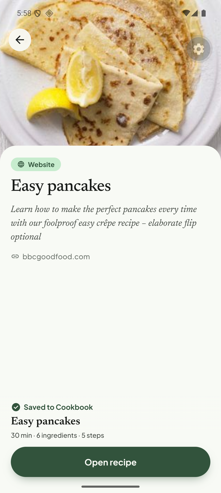

# Q05. Blocked sites, slow failures and low-res thumbnails

🟠 Medium · API worker · Findings **F73, F74, F43**

## Problem

1. **Popular recipe sites are unreachable.** `simplyrecipes.com` blocks the plain HTTP fetch (`web.fetch blocked by the site` in the worker log) and only works through the Apify fallback after **~45 s**, and then hits [Q01](Q01-ingredient-units-and-ranges.md). `cookieandkate.com` fails after **16 s** with `Apify could not load the page (status 500)` → a generic failure.
2. **A non-existent Instagram reel takes 43 s to fail** (retries) and the job error has a doubled message: `Post does not exist: Post does not exist`. The user only sees a generic toast.
3. **Low-res thumbnail:** BBC's thumbnail URL ends in `?resize=440%2C230` and is stretched to a 1080 px hero (soft).
4. For blocked sites the share preview only knows the hostname ("Couldn't load a preview. You can still import it.") even though the import itself can succeed.

## Evidence

Jobs table: `…instagram.com/reel/C9xQ2ZkLmNp/ | FAILED | CONTENT_ACQUISITION_FAILED | 43 s`; `…cookieandkate.com/… | FAILED | Apify could not load the page (status 500) | 16 s`.

## Root cause

1. **Verified (log):** the generic fetcher gets a block page (HTTP 403/bot wall) and the pipeline falls back to Apify. Apify pages are slow and sometimes 500.
2. **Verified (job error):** `CONTENT_ACQUISITION_FAILED` is retried with backoff (`EXTRACTION_MAX_RETRIES=5`, `EXTRACTION_BACKOFF_MS=1000`) even for **permanent** causes (`Post does not exist`). The message is built as `${message}: ${cause}` where `message` already contains the cause.
3. **Hypothesis:** the og:image / JSON-LD `image` array is used as-is; the BBC array has several sizes and the first is a small crop.

## Fix

1. **Classify failures:** `Post does not exist`, 404/410, private account, login wall → **non-retryable** (`CONTENT_NOT_FOUND` / `CONTENT_PRIVATE`), fail in < 5 s. Keep retries for 5xx/timeouts only. Give each code a user-facing sentence (hook into `importFailureToast`, see [Q08](Q08-supported-sources-and-error-copy.md)).
2. Fix the duplicated message construction.
3. Browser-like fetch for the generic path: realistic headers (UA, Accept-Language), follow redirects, detect block pages (short HTML with "access issue" or captcha text) and go to the fallback **immediately**, instead of after a timeout. Set a timeout budget (e.g. 20 s total) and surface "This site blocks automatic import" when exhausted.
4. Prefer a clean JSON-LD `Recipe` from the fallback HTML before the LLM path, so units survive (links to Q01).
5. Thumbnails: choose the **largest** image in the JSON-LD `image` array / `og:image`; strip known resize query params (`resize=`, `w=`, `width=`); fall back to `og:image` when JSON-LD has only tiny variants. Store the chosen URL in `recipe_sources.metadata.thumbnailUrl`.
6. Preview endpoint (`apps/api/src/modules/content/preview/link-preview.service.ts`, `open-graph.ts`, `unfurlers/youtube.unfurler.ts`; the app calls it through `features/link-preview`): when the plain fetch is blocked, return the og data from the fallback (or `blocked: true`) so the share screen can say "This site blocks previews, import still works" instead of looking broken.

## Acceptance criteria

- Instagram "post does not exist" fails in < 5 s with a specific message and no duplicated text.
- A blocked site fails fast with "This site blocks automatic import" (or succeeds), never a silent 45 s wait.
- BBC thumbnail is ≥ 800 px wide.
- Preview for a blocked site distinguishes "blocked" from "offline".

## Tests

- Vitest: error classifier (retryable vs permanent) with fixtures from Apify responses; thumbnail picker; message construction.
- Manual: dead Instagram reel, `cookieandkate.com`, `simplyrecipes.com` via the share intent. Note: the Apify token is required for the fallback.
