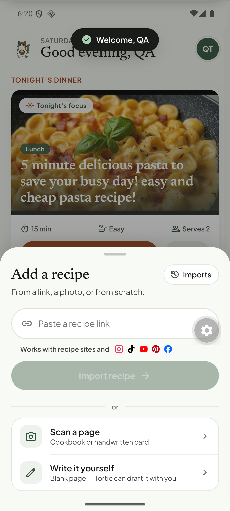

# Q06. Meal-type tag and the "Tonight's dinner" hero

🟡 Low (copy/logic) · API + mobile · Findings **F21, F38, F54**

## Problem

* The Today hero is headed **"TONIGHT'S DINNER"** with a **"Tonight's focus"** badge, but the recipe it shows is tagged **Breakfast** (pancakes) or **Lunch** (pasta that was planned for dinner).
* When nothing is planned, the hero **falls back to the newest recipe** and presents it as tonight's dinner anyway.
* The meal-type label on the detail page is a guess: guacamole **LUNCH**, pasta **LUNCH**, pancakes **BREAKFAST**.

## Evidence




## Root cause (verified)

`Tonight` in `tortie/screens/today.tsx`:

```ts
const plannedId = week[todayIndex()]?.d ?? null;      // dinner slot
const id = plannedId ?? list[0]?.id ?? null;          // fallback = newest recipe
…
<T …>Tonight’s dinner</T>                             // always this label
```

The label is static, and the tag shown on the card is the recipe's **own** category, not the slot it was planned in: `toTRecipe` sets `tag: cats[0] ?? (cuisine || sourceLabel || 'Recipe')` where `cats` are the recipe's categories (`tortie/data/recipes.ts`). The categories are chosen on the server: the extraction prompt asks the model for `categorySlugs` (`breakfast | lunch | dinner | sweet`, `recipe-extraction-v1.ts` l.83), `normalizeRecipeCategorySlugs(extracted.categorySlugs, title, description)` post-processes them (`recipe-normalizer.ts`), and anything missing defaults to `['dinner']` (`stage-orchestrator.ts`, `recipe.repository.ts` `create`). So guacamole and the pasta came back as *Lunch* and pancakes as *Breakfast* from the model's guess, and a recipe with no usable answer silently becomes *Dinner*.

## Fix

1. Hero label by state:
   * a **dinner** is planned → "Tonight's dinner" and show the *slot* ("Dinner") instead of the recipe's guessed type;
   * only breakfast/lunch planned → "Today's plan";
   * nothing planned → "Pick something for tonight" with the newest recipe as a **suggestion**, badge "Suggested", and a "Plan it" action. Do not call it "Tonight's focus".
2. Meal-type guess: use the source's JSON-LD `recipeCategory` when present, then the model's `categorySlugs`. Let the model return an empty list when unsure, and **don't default to `dinner`** (`stage-orchestrator.ts`): hide the tag instead. A recipe like guacamole (dip/side) fits none of the four categories, so allow `snack`/`side` or no category.
3. Make the badge on a planned card show the **slot** it occupies.

## Acceptance criteria

- No state shows "Tonight's dinner" over a recipe whose label says Breakfast/Lunch.
- Empty plan → suggestion wording, not "focus".
- Guacamole/pasta/pancakes get plausible tags or none.

## Tests

- Jest for the hero-state helper (planned dinner / planned lunch only / empty / loading).
- Mapper test for meal-type from `recipeCategory`.
