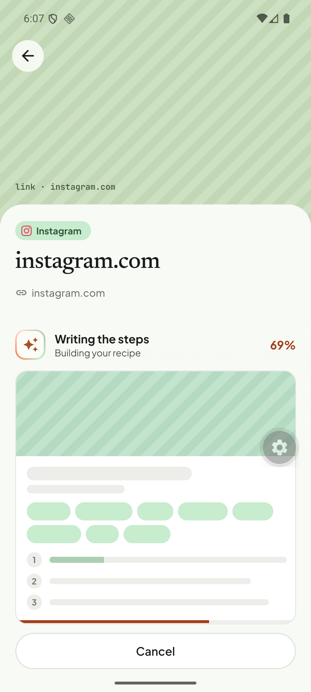
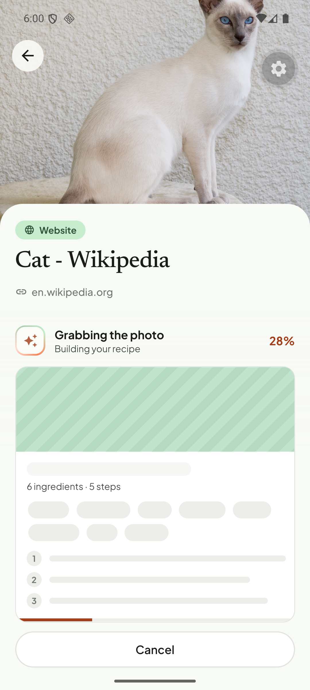
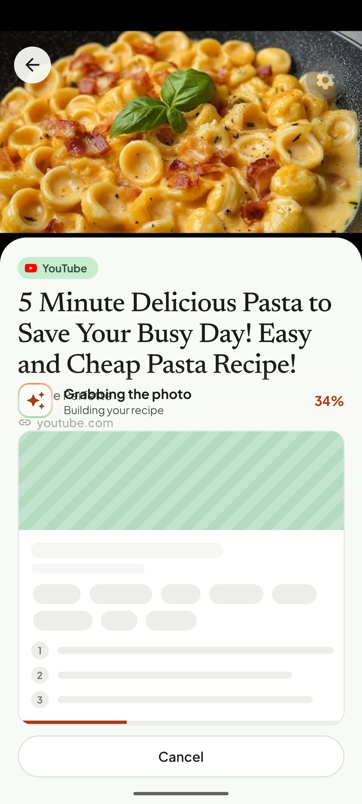

# Q07. Import progress must reflect the real job

🔴 High · mobile · Findings **F72, F46, F45, F34**

## Problem

1. **Progress is time-based, not real.** An Instagram import showed **"Writing the steps — 69 %"** while the server job was still `ACQUIRING_CONTENT` at 5 %. A Wikipedia link that the server rejected in ~1 s still animated to 28–34 % "Grabbing the photo / Building your recipe" before the error appeared.
2. **Stale recipe counts.** The skeleton card under the progress shows "**6 ingredients · 5 steps**" for a *different* link, copied from the previous successful import.
3. **Overlap.** In the share screen the progress row ("Grabbing the photo 34 %") is drawn on top of the channel name and the domain line.
4. For YouTube the label "Grabbing the photo" shows even though the thumbnail is already on screen. The skeleton hero is a striped box instead of keeping the known thumbnail.

## Evidence

## Root cause

1. **Verified.** `tortie/data/import-engine.ts` `tick()`:
   `target = recipeId ? 100 : min(94, max(serverProgress, creep))` where `creep = 94 * (1 - exp(-t / 9000))`. The stage label is derived from this number (`features/extraction/import-stages.ts`: 0 Reading, 18 Grabbing the photo, 34 Picking out ingredients, 66 Writing the steps, 94 Plating). Wall-clock time, not the job, drives the label. The share screen has **its own copy** of this logic (`features/share/use-shared-import.ts`).
2. **Verified.** In `use-shared-import.ts`, `fail()` resets `phase/pct/jobId` but **not `recipeId`** (`cancel()` and the nonce effect both call `setRecipeId(null)`). `useTRecipe(recipeId)` keeps returning the previous recipe, and `ImportProgress` renders `plz(recipe.ingCount,'ingredient') · plz(recipe.stepCount,'step')` from it.
3. **Verified.** `ImportProgress` (`tortie/ui/import-progress.tsx`) is positioned over the share header in `share-preview.tsx` (absolute/stacked layout); see the screenshot.

## Fix

1. **Drive the label from `job.status`** (server `currentStage`): `ACQUIRING_CONTENT`→Reading the page, `PROCESSING_MEDIA`/`TRANSCRIBING`/`ANALYZING_FRAMES`/`RUNNING_OCR`→Picking out ingredients (or a stage-specific caption), `EXTRACTING_RECIPE`/`NORMALIZING_RECIPE`/`VALIDATING_RECIPE`→Writing the steps, completed→Plating it up. Map in one function next to the server stage enum.
2. **Cap the creep** to the next stage boundary so the bar never passes the stage the server reports (e.g. while `ACQUIRING_CONTENT`, max ~18 %). Keep a gentle creep inside the stage.
3. **Unify** the two implementations: `use-shared-import.ts` should use `startImport` / the engine's store instead of its own timers (one source of truth, one set of tests).
4. In `fail()` call `setRecipeId(null)` (and reset `srcName`). Do not show counts until the **current** job's recipe exists.
5. Layout: render the progress block *below* the header block in `share-preview.tsx`; keep the already-fetched thumbnail visible during the import (no striped placeholder when a thumbnail exists).
6. Quick fail: when the server job is already `FAILED`, stop the animation immediately (the poll interval is 4 s: `POLL_MS = 4000`; poll faster for the first ~10 s).

## Acceptance criteria

- The caption never says a later stage than the server job's stage.
- A rejected link goes straight to the error: no more than one poll interval of progress animation.
- Two imports in a row never show the previous recipe's counts.
- No overlap in the share screen on a Pixel 6 and a small phone (360 dp wide).

## Tests

- Jest: stage mapper (all `JobStatus` values), creep-cap helper, `use-shared-import` reset on failure (render hook, simulate FAILED then new import → no stale recipe).
- Manual: Wikipedia link, dead Instagram reel, a slow YouTube video.
