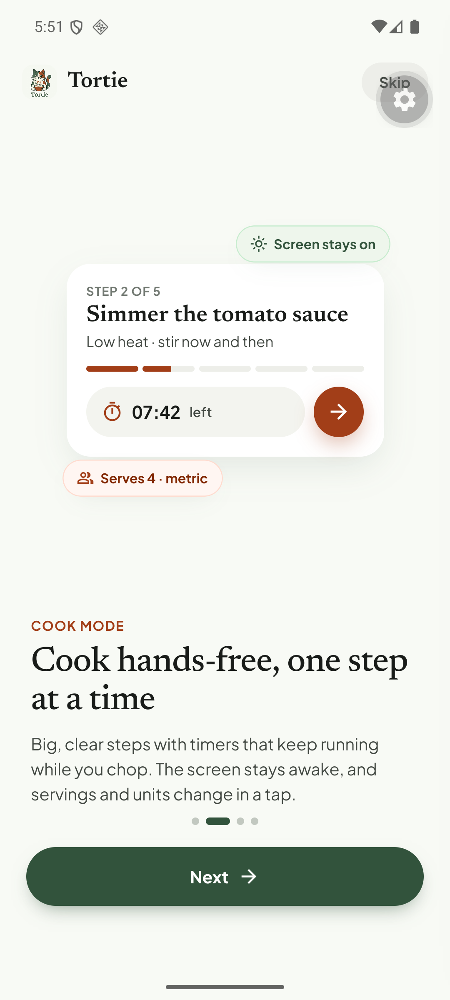
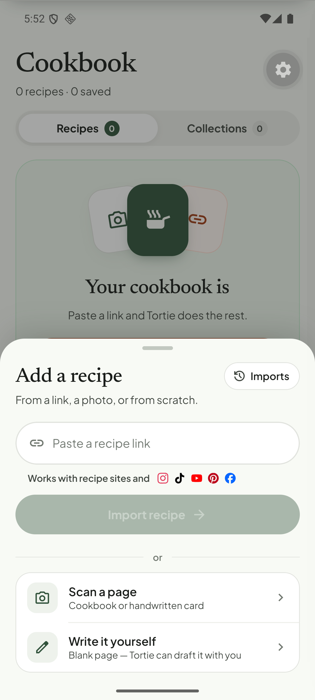
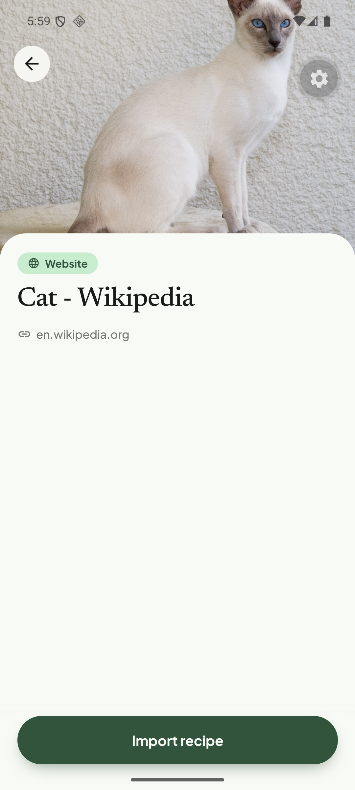
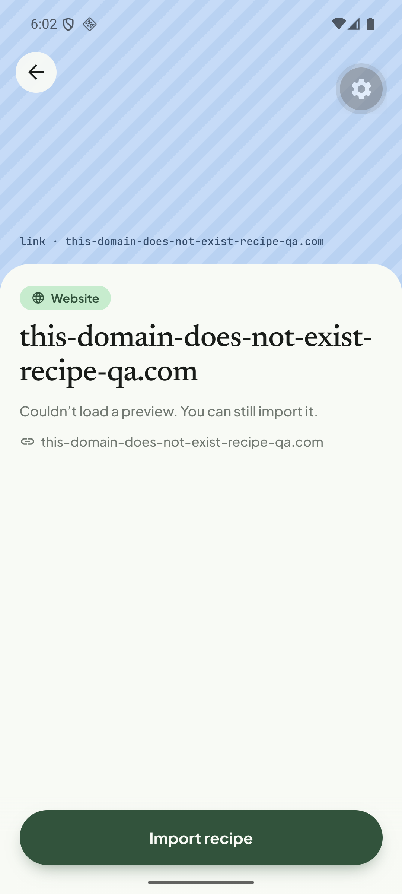
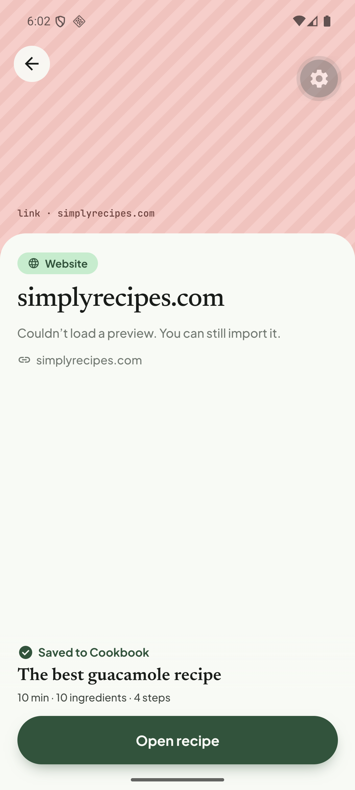

# Q08. Advertised vs supported sources; preview and error copy

🟠 Medium · mobile (+ small API) · Findings **F50, F05, F12, F47, F52, F53**

## Problem

1. **TikTok and Facebook are advertised but unsupported.** Onboarding slide 1 and the Add sheet ("Works with recipe sites and 📷 ♪ ▶ 📌 f") show Instagram, TikTok, YouTube, Pinterest and Facebook. A shared TikTok link gets a preview titled **"TikTok - Make Your Day"** (the login-wall title) and an enabled **"Import from TikTok"** button. It fails with `UNSUPPORTED_SOURCE` only after the tap.
2. **Non-recipe pages are importable:** Wikipedia "Cat" has a normal preview and an enabled **Import recipe** button. The server rejects it with `NOT_A_RECIPE` after a wasted wait.
3. **Wrong error for a dead domain:** the toast says **"That link isn't supported yet — try a website, I…"** (it *is* a website) and is truncated.
4. **Duplicate import** says "Saved to Cookbook" with no explanation.
5. Instagram preview: just the hostname `instagram.com` as the title, no image/caption.

## Evidence

## Root cause

* **Verified:** the supported list is hard-coded in the UI (`SOURCES` in `tortie/screens/add-recipe.tsx` and the near-duplicate `SOURCES` in `features/share/url.ts`, both listing TikTok/Pinterest/Facebook; plus the onboarding copy) and not tied to `SourceType` handling in the worker (TikTok/Facebook → `UNSUPPORTED_SOURCE`).
* **Verified:** for a host that does not resolve, `assertSafeUrl` (`apps/api/src/infrastructure/security/ssrf-guard.ts`) throws `INVALID_URL` (HTTP 400, "URL hostname could not be resolved") at create time, before any job exists. `importFailureToast` (`apps/mobile/src/lib/user-error.ts`) maps `UNSUPPORTED_SOURCE` **and** `INVALID_URL` to the same sentence: "… isn't supported yet — try a website, Instagram or YouTube". So a typo'd domain reads as an unsupported source. The sentence also lists only three sources.
* **Verified:** the preview comes from `apps/api/src/modules/content/preview/link-preview.service.ts` (Open Graph tags + a YouTube unfurler) and is requested by the app through `features/link-preview`; it has no notion of "is this a recipe".

## Fix

1. Single source of truth: export `SUPPORTED_SOURCES` (+ `partial`) from `@recipe/contracts` (or an API `/capabilities` response). Use it in onboarding, the Add sheet icons and the share preview. Until TikTok/Facebook work, **remove them from the marketing strip** (or mark "coming soon").
2. Share preview for an unsupported source: disable the CTA and show an inline explanation ("TikTok links can't be imported yet. Share the creator's recipe page or write it down") instead of a toast after the tap. Never show the login-wall title: for TikTok/Facebook show only the source chip and the domain.
3. Non-recipe pre-check: add a cheap `POST /recipes/extract/precheck` (or reuse the classifier keyword path `recipe-signals.ts`) and show "This doesn't look like a recipe" **in the preview**, with "Import anyway" secondary. Server stays the authority.
4. Error copy: give `INVALID_URL` its own sentence ("That doesn't look like a valid link — check the address"; for the DNS case "We couldn't find that site. Check the address and try again"). Add the distinct codes `BLOCKED`, `NOT_FOUND` (see [Q05](Q05-site-access-and-failures.md)) next to the existing `UNSUPPORTED_SOURCE`, `NOT_A_RECIPE`, `CONTENT_ACQUISITION_FAILED`. Keep every message ≤ 2 lines (see [Q09](Q09-toasts.md)).
5. Duplicates: the extract response already has `deduplicated: true`. Show "Already in your cookbook" with an **Open** action.
6. Instagram preview: if no og data, show the Instagram chip and "Preview not available. You can still import it" rather than the hostname as a title.

## Acceptance criteria

- No UI element promises a source the backend rejects.
- TikTok/Facebook share: the CTA is disabled (or absent) and the reason is visible without tapping.
- Wikipedia share shows "doesn't look like a recipe" before any import starts.
- Dead domain shows "We couldn't reach that link".
- Duplicate shows "Already in your cookbook".

## Tests

- Jest: `importFailureToast` for each code and for a network error; `SUPPORTED_SOURCES` drives the strip.
- API: precheck endpoint for a recipe page, a news page and an empty page.
- Manual with the share intent: TikTok, Wikipedia, dead domain, duplicate.
