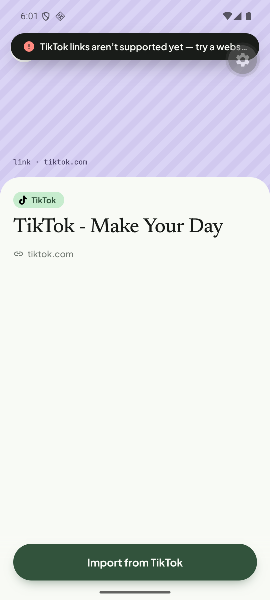
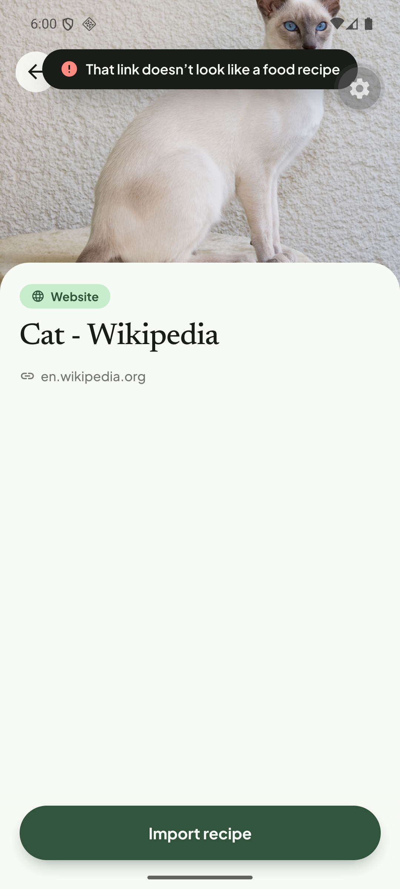
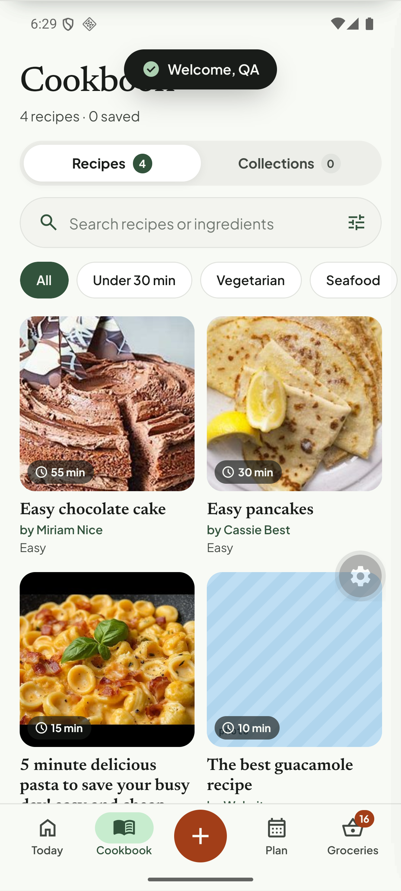
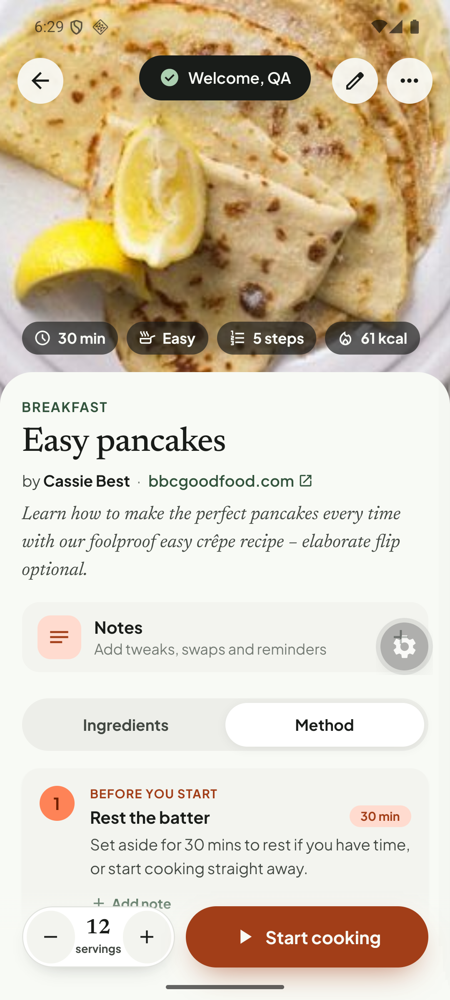

# Q09. Toasts: overlap, truncation and a stuck toast

🟠 Medium · mobile · Findings **F51, F79** (and the "Welcome, QA" overlaps)

## Problem

1. Error toasts are **one line and truncated**: "TikTok links aren't supported yet — try a webs…", "That link isn't supported yet — try a website, I…".
2. The toast is drawn **on top of the header controls** (back button, page titles): "Welcome, QA" covers the "Cookbook" title, the greeting and the Imports header; error toasts cover the back button.
3. **Stuck toast:** "Welcome, QA" (shown after login) was still on screen ~9 minutes later on Cookbook and on a recipe detail page.

## Evidence

## Root cause

* **Verified (hide timer):** `toastShow` in `tortie/nav-store.ts` sets `toastOn: true` and a single module-level `setTimeout(() => set({ toastOn: false }), err ? 3800 : 2400)`. Nothing else hides it.
* **Hypothesis (stuck):** the sign-in flow calls `toast()` inside `close()` while the auth overlay is unmounting; if the JS timer is created while the app is backgrounded (dev client reload / the emulator restart in this session) or `toastOn` is flipped by a later `set` that re-asserts `toastOn: true`, the hide never fires. **Repro to confirm:** log in, wait 10 s; log in, background the app for 5 s and return. Also check the toast component's own animation (`shell.tsx`) — it may be keyed on `toastNonce` and never receive `toastOn: false` after a remount.
* **Verified (layout):** the toast container sits at a fixed top offset (below the status bar) over page headers; `numberOfLines={1}` + `ellipsizeMode` truncates.

## Fix

1. Toast component: allow **2 lines** (`numberOfLines={2}`), max width = screen − 32, and measure.
2. Position: bottom-anchored above the tab bar (or below the header for screens that have one) so it never covers the back button / title. Respect safe-area insets.
3. Lifecycle: store the hide timestamp and make the toast component hide itself from an effect keyed on `toastNonce` (`useEffect(() => { const t = setTimeout(hide, ms); return () => clearTimeout(t) }, [nonce])`), plus an `AppState` listener that hides it when the app returns to foreground after its deadline. Add a swipe/tap to dismiss.
4. Do not call `toast()` from an unmounting overlay: move the success toast out of `SignIn.close()` into the auth-store transition.

## Acceptance criteria

- No toast is truncated to one line when the message is ≤ 90 characters.
- A toast never covers a back button, title or primary control.
- Every toast disappears within its duration, including after backgrounding the app.

## Tests

- Jest with fake timers: `toastShow` → advance 2.4 s / 3.8 s → `toastOn === false`; second toast replaces the first and restarts the timer.
- Manual: login (stuck repro), TikTok error, Wikipedia error.
