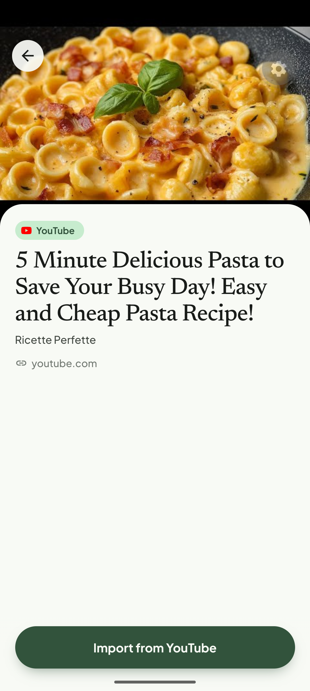
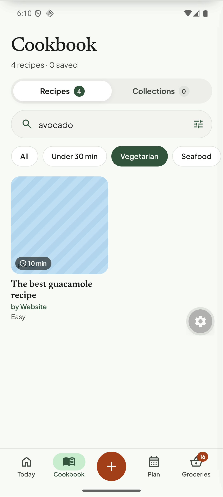

# Q10. YouTube letter-boxed thumbnails

🟡 Low · API (thumbnail choice) + mobile · Findings **F33, F37, F56**

## Problem

YouTube thumbnails (`hqdefault.jpg`, 4:3) include **black bars** above and below the 16:9 picture. They show as black bands in the share preview, the recipe hero, Cookbook cards (the time chip sits on black), Plan rows and the Today hero. Inconsistent with web recipes, which fill the frame.

## Evidence

## Root cause (verified)

`recipe_sources.metadata.thumbnailUrl` = `https://i.ytimg.com/vi/<id>/hqdefault.jpg`, and the preview uses the same image (see `modules/content/preview/unfurlers/youtube.unfurler.ts`). That file is 480×360 with baked-in letterboxing for 16:9 videos.

## Fix

1. API: for YouTube, request in order `maxresdefault.jpg` (1280×720, no bars) → `sddefault.jpg` (640×480, bars) → `hqdefault.jpg`. Probe with a `HEAD` and keep the first that returns 200 and is not the 120×90 placeholder (Content-Length small). Prefer the `thumbnails` array from `yt-dlp` and pick the widest non-`_live` one (`maxresdefault`), not the default.
2. Mobile fallback for existing rows: in the `expo-image` card use `contentFit="cover"` with a **crop** for YouTube hosts (`i.ytimg.com`) — scale the image by 1.34 so the 16:9 region fills the box, or request `/vi/<id>/maxresdefault.jpg` by URL rewrite.
3. Backfill (optional): rewrite stored `thumbnailUrl` for `provider = 'yt-dlp'` rows.

## Acceptance criteria

- New YouTube imports show a full-bleed image in preview, hero, cards, plan row and Today.
- Existing YouTube recipes also look right (URL rewrite or crop).

## Tests

- Vitest: thumbnail picker with a mocked `HEAD` (200 / 404 / placeholder size).
- Manual: re-import the pasta video via the share intent.
