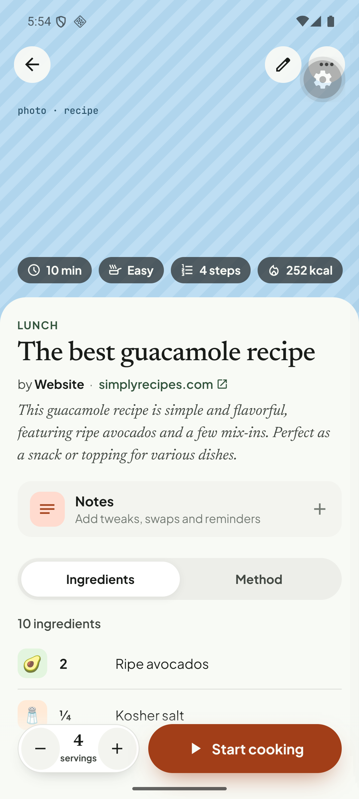
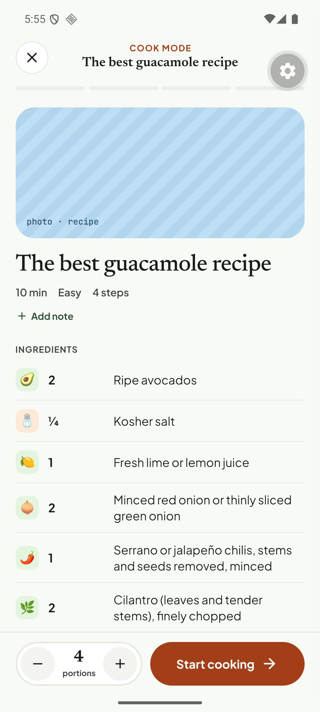
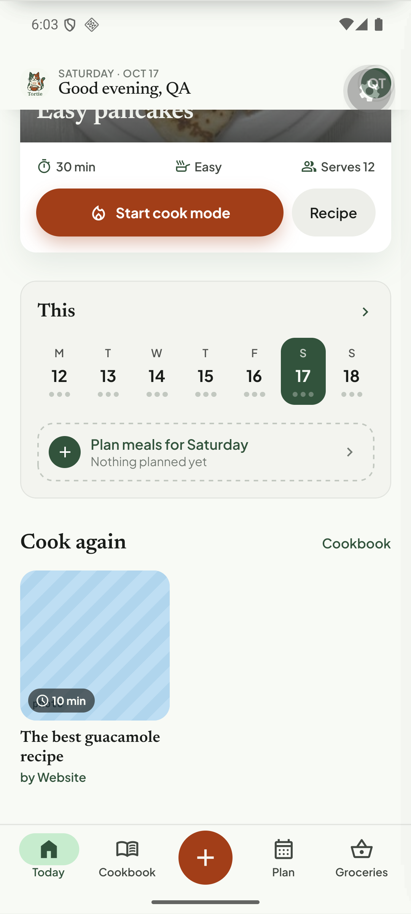
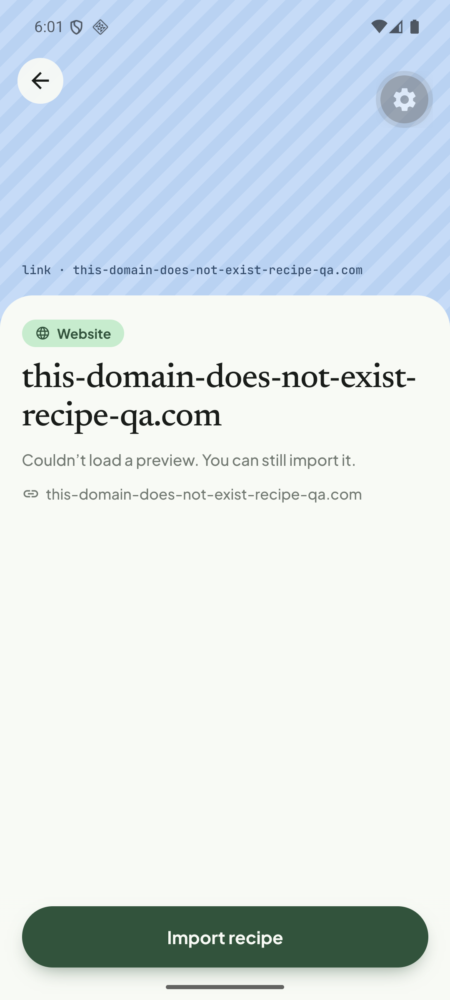

# Q11. Dev placeholder text in the UI

🟡 Low · mobile · Finding **F18**

## Problem

The striped image placeholder prints mono-spaced **design-mock text** in the production UI:

* On recipe detail / cook overview / Today "Cook again" / Cookbook cards: **"photo · recipe"** (the word "photo" is partly visible behind the time chip).
* In the share preview for links without an image: **`link · tiktok.com`**, **`link · instagram.com`**, **`link · this-domain-does-not-exist-recipe-qa.com`**.

## Evidence

## Root cause

**Verified.** `tortie/ui/photo.tsx` renders a mono `caption` over the striped placeholder ("Hidden when a real image is shown"). Callers pass design-mock strings: `'photo · ' + r.photo` in `recipe-detail.tsx`, `cook.tsx`, `editor.tsx` (`'photo · ' + photoWord`) and `today.tsx` (the "Cook again" card), and `'link · ' + host` in `share-preview.tsx`. `TRecipe.photo` is documented as the "Placeholder caption subject: photo · {photo}" (`tortie/data/recipes.ts`). They are leftovers from the HTML prototype, where the caption described the missing image.

## Fix

1. Stop passing `caption` in the five call sites above (and drop `TRecipe.photo` if nothing else uses it). Render no text, or a neutral glyph (`restaurant` icon for recipes, `link` for previews) centred in the stripes.
2. Make the placeholder accessible: `accessibilityLabel="No photo"` on the view, nothing visible.
3. Keep the label only behind `__DEV__` if the team wants it in design builds.
4. Check the time chip layout over the placeholder once the label is gone.

## Acceptance criteria

- No mono-spaced placeholder text anywhere (search the UI for `F.mono` captions on image placeholders).
- Placeholders still look intentional (stripe hue per recipe).

## Tests

- Snapshot/Jest render test for the placeholder with and without `__DEV__`; grep guard (lint rule or test) that fails on the literals `'photo · recipe'` and `` `link · `` in production paths.
