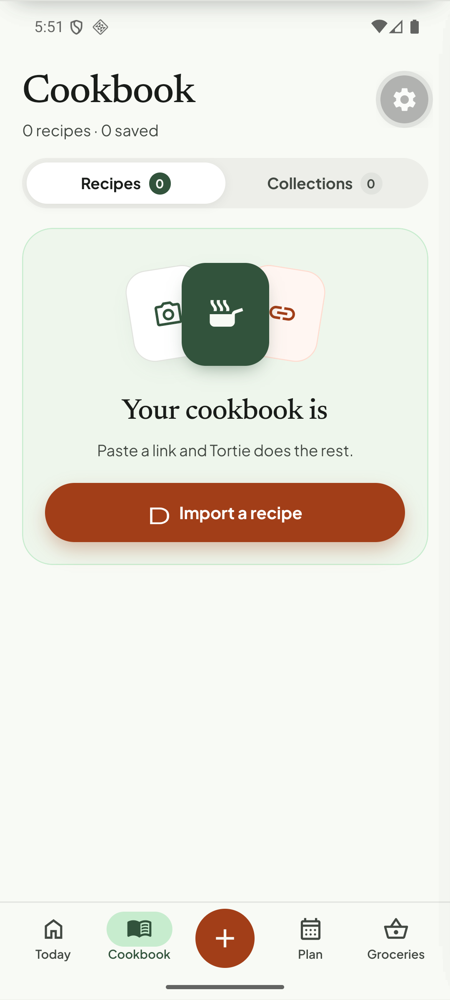
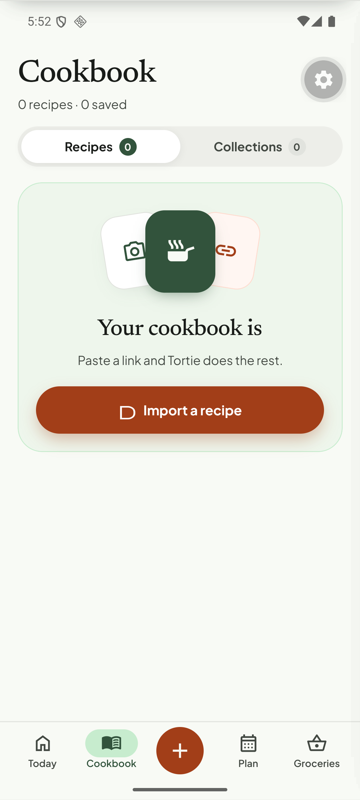
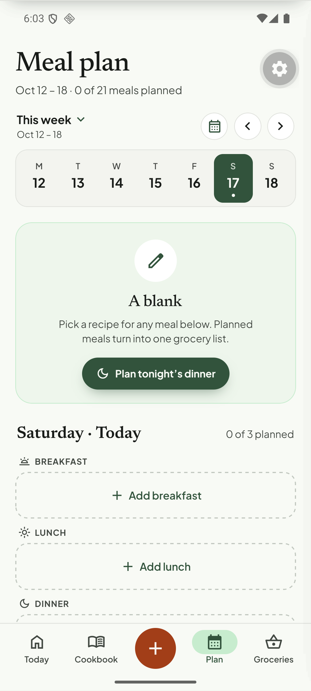
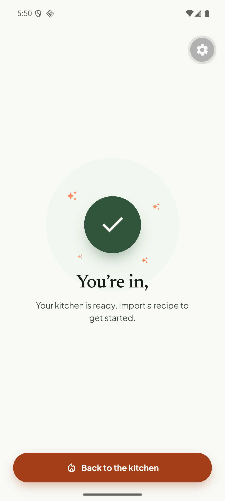
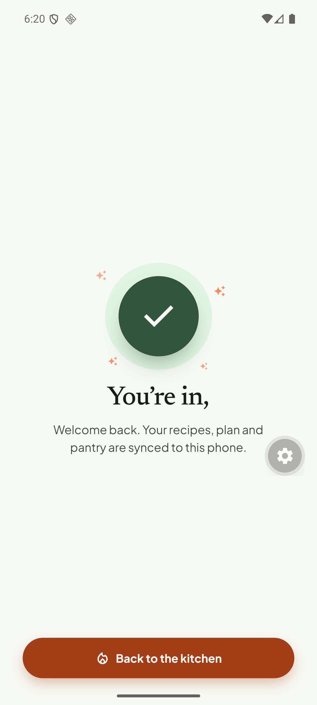

# Q12. Last word of serif headings is dropped

🔴 High (visible on 5 screens, one root cause) · mobile · Finding **F09** (also explains the dangling comma in F02)

## Problem

On Android, centred or shrink-wrapped Newsreader headings lose their **last word**. It is reproducible, persists after 5 s (not an animation), and survives re-login.

| Screen | Source text | Rendered |
| --- | --- | --- |
| Cookbook, empty library | `Your cookbook is empty` | **Your cookbook is** |
| Plan, empty library (kicker) | `An open week` | **An open** |
| Plan, empty week card | `A blank week` | **A blank** |
| Today, "This week" card | `This week` | **This** |
| Sign-up / login success | `You’re in, ${first}` (first = "QA") | **You're in,** |

The bigger page titles ("Cookbook", "Meal plan", "Groceries") and the Today greeting are fine.

## Evidence

## Root cause (hypothesis, with a 15-minute experiment)

* Verified facts: the affected strings are rendered with `serif()` from `tortie/ui/text.tsx` (Newsreader 500/600 or `serif400i`), often with `letterSpacing: em(size, -0.02)` and `textAlign: 'center'`. `serif()` always sets an explicit `lineHeight` (`Math.ceil(size * SERIF_BOX)` = 1.43 em unless one is passed) and `includeFontPadding: false`. `T` is a bare `Text` with `allowFontScaling={false}`.
* The three "This week / A blank week / An open week" cases contain a short string that fits easily on one line, so this is **not** ordinary wrapping. The pattern "shrink-wrapped Text measured with one font, drawn with another" (width computed from a fallback font before Newsreader is registered, or from a layout pass that ignores letter-spacing) produces exactly this: the text gets a width a few px too small, the last word wraps to a second line, and the parent's fixed height / `overflow: hidden` hides it.
* **Experiment (do first):** (1) `adb shell setprop debug.layout true` and restart the app to see the Text bounds; (2) on one affected string, add `numberOfLines={1}` and a visible `backgroundColor` — if the word appears or ellipsis shows, it is the wrap-then-clip case; (3) remove `letterSpacing` only; (4) remove `textAlignVertical`/`includeFontPadding`; (5) gate the first render on `useFonts` ready (check `app/_layout.tsx`); (6) test in a release build and on a physical device. The first change that makes the word reappear is the cause.

## Fix (pick after the experiment)

* If it is font-load timing: do not render the tabs before fonts are loaded (hold the splash) and key the screens on the fonts-ready flag.
* If it is letter-spacing/Fabric measure: remove negative `letterSpacing` from `serif()` users below ~28 px, or add `paddingRight: ceil(|spacing| × chars)` to centred titles, or set `flexShrink: 0` and explicit `maxWidth`.
* If it is height clipping: let headings grow (`minHeight` instead of fixed `height`) and add `lineHeight ≥ 1.2 × size` for the italic kicker.
* Add one shared `Heading` component that encodes the working combination, then migrate the five call sites (`first-recipe.tsx` ⚠ WIP, `empty-state.tsx` ⚠ WIP, `today.tsx` "This week", `sign-in.tsx` success title, `plan.tsx`).

## Acceptance criteria

- All five strings render in full on a Pixel 6 emulator, a 360 dp phone and with system font size 130 %.
- A grep-based or screenshot test over the strings above (Maestro flow `apps/mobile/.maestro/flows/`) passes: assert text `Your cookbook is empty`, `This week`, `A blank week`, `An open week`, `You’re in, QA` are visible.

## Tests

- Maestro: new flow `headings.yaml` with `assertVisible` for each exact string (Maestro reads the accessibility text, so it will catch a truncated render).
- Jest: unit test of the new `Heading` props only (no layout).
