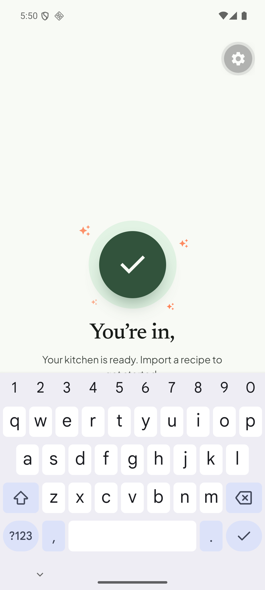
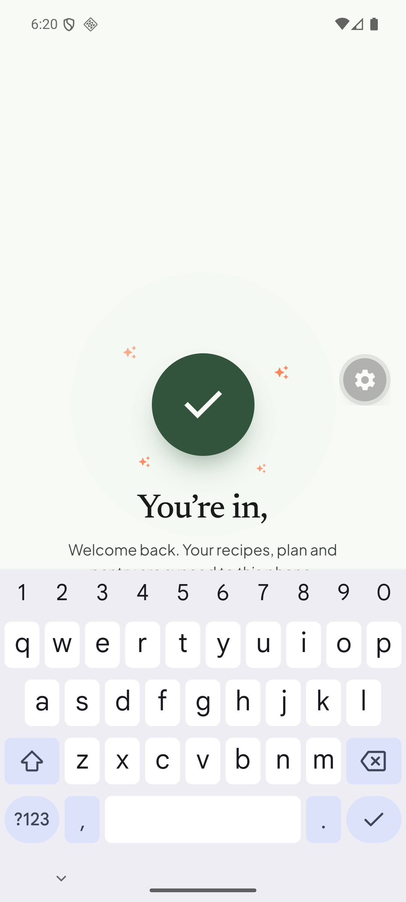
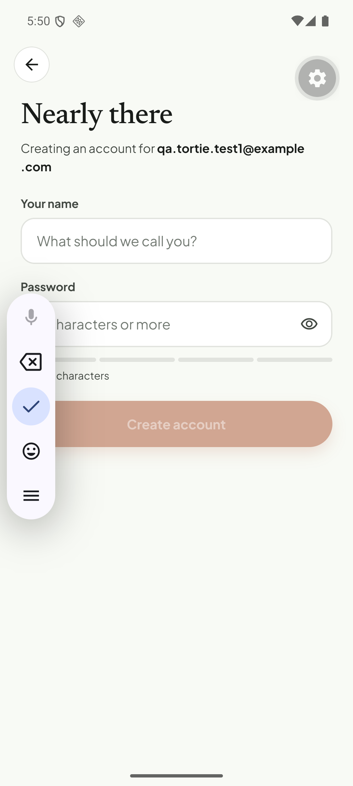

# Q13. Keyboard covers the sign-in success screen; wording

🟠 Medium · mobile · Findings **F02, F03, F04, F02c**

## Problem

1. After **sign-up** and after **login** the software keyboard stays open on top of the success screen. It hides the explanatory line ("Welcome back. Your recipes, plan and pantry are synced to this phone") and the **"Back to the kitchen"** button, so the user has to dismiss the keyboard first.
2. The title reads **"You're in,"** with a dangling comma ([Q12](Q12-heading-last-word-clipped.md): the name is dropped by the clipping bug, not missing from the data).
3. A brand-new user sees **"Back to the kitchen"**: "back" is wrong for someone who has never been there.
4. Sign-up step 2 shows the email in a pill that wraps `.com` onto a second line (F01).
5. The "Welcome, QA" toast fires from `close()` and overlaps the greeting ([Q09](Q09-toasts.md)).

## Evidence

## Root cause

* **Verified:** `tortie/screens/sign-in.tsx` moves `auStep` to `'done'` while the password `TextInput` still has focus; nothing calls `Keyboard.dismiss()` / `blur()`. Title text is `` first === 'there' ? 'You’re in' : `You’re in, ${first}` `` (l.~703); CTA copy is static.
* **Verified:** the email pill has no `numberOfLines`/`flexShrink` so a long address wraps.

## Fix

1. On entering `step === 'done'`: `Keyboard.dismiss()` and blur the focused input (effect on `step`).
2. CTA copy by mode: sign-up → **"Start cooking"** / "Add your first recipe" (goes to the welcome tour), login → "Back to the kitchen".
3. Pill: `numberOfLines={1}` + `ellipsizeMode="middle"` + `flexShrink: 1`.
4. Fix the heading per Q12; keep `first` formatting ("You're in, QA").
5. Fire the welcome toast after the overlay is gone (or drop it: the success screen already says it).

## Acceptance criteria

- The success screen is fully visible, button tappable, with no keyboard, on both flows.
- Sign-up CTA does not say "back".
- Email pill stays on one line (middle-ellipsis for > 28 chars).

## Tests

- Maestro: sign-up flow → `assertVisible: "Start cooking"` without tapping elsewhere; login flow → `assertVisible: "Back to the kitchen"`.
- Jest: CTA label selector for `mode`.
