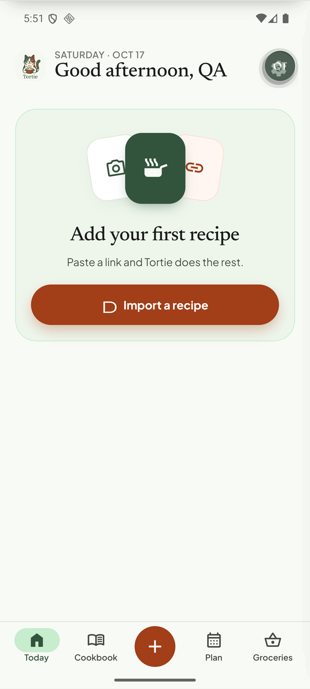

# Q14. Icon names that are missing from the bundled icon fonts

🟡 Low severity, high visibility · mobile · Findings **F08, F63**

## Problem

Several icons render as **a plain letter or a blob** instead of the intended symbol:

* Profile → Help → **"Take the tour"**: a "T" (name `tour`).
* The **"Import a recipe"** buttons (Today empty state, Cookbook empty hero): an outlined "D" blob (name `download`).
* **Imports** empty state: a "C" tile (name `cloud_download`).
* Probably also the empty-state art for Cookbook/Plan (`restaurant`, `edit_calendar`, `favorite`, `search_off`) and Notes (`edit_note`, `chat`): check each.

## Evidence





## Root cause (verified)

`tortie/ui/icon.tsx` renders Material Symbols **by ligature**: `<Text style={{fontFamily: 'MaterialSymbolsOutlined'}}>{name}</Text>`. The fonts in `apps/mobile/assets/fonts/` are **subsets** (≈ 40 KB each, 261 ligatures). A name that has no ligature is drawn as ordinary characters (or a notdef box).

I extracted the GSUB ligatures of both TTFs and compared them with every literal icon name in `apps/mobile/src` (including the uncommitted work). **Not in either font (18):**

`add_link`, `cake`, `chat`, `cloud_done`, `cloud_download`, `cloud_off`, `delete_forever`, `dinner_dining`, `download`, `edit_calendar`, `edit_note`, `favorite`, `filter_alt_off`, `folder_open`, `restaurant`, `restaurant_menu`, `search_off`, `tour`.

(The script is in the task notes below. It only sees literal names, so dynamic names (`name={cond ? 'a' : 'b'}`, maps) need a manual pass.)

## Fix

1. **Regenerate the subsets** to include every name the app uses. Keep the generated name list in the repo (`apps/mobile/assets/fonts/icon-names.json`) and a script (`pyftsubset` over the full Material Symbols variable font with `--text=<ligature names>` + `--layout-features=liga`, plus `FILL` axis for the fill font) so adding an icon is one command.
2. Or map the missing names to existing ones (`restaurant`→`skillet`, `download`→`file_download` if present, `cloud_download`→`link`, …) if the design allows. Check `ui/first-recipe.tsx` where `KITCHEN_ICONS = ['photo_camera','skillet','link']` already works.
3. **Guard:** add a Jest test that parses the source for literal `Glyph name`/`Icon name`/`icons={[…]}` values and asserts each exists in `icon-names.json`. This stops the next regression at PR time.
4. Runtime guard: in `__DEV__`, `Icon`/`Glyph` log a warning when the name is not in the list.

## Acceptance criteria

- All 18 names above render a real symbol (screenshot Profile, Imports, Today empty, Cookbook empty, Plan empty, Notes empty).
- The Jest guard fails when a new unknown icon name is added.

## Notes: the audit script

```python
# apps/mobile: python scripts/icon-audit.py  (fontTools required)
from fontTools.ttLib import TTFont
def ligatures(path):
    f = TTFont(path); cmap = f.getBestCmap(); rev = {v: chr(k) for k, v in cmap.items()}; out = set()
    for lk in f['GSUB'].table.LookupList.Lookup:
        for st in lk.SubTable:
            st = getattr(st, 'ExtSubTable', st)
            if hasattr(st, 'ligatures'):
                for first, ls in st.ligatures.items():
                    for l in ls:
                        out.add(''.join(rev[g] for g in [first] + list(l.Component)))
    return out
```
