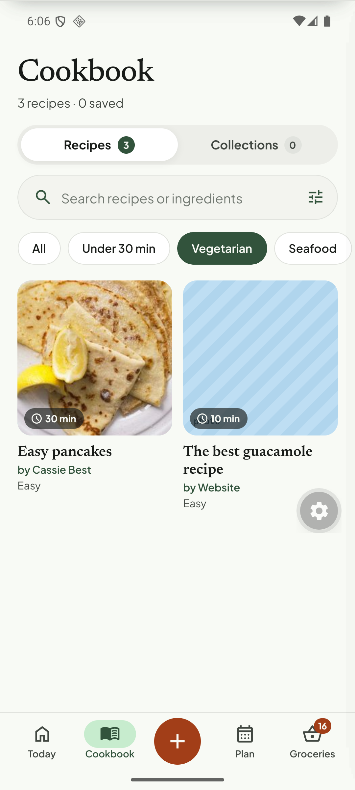
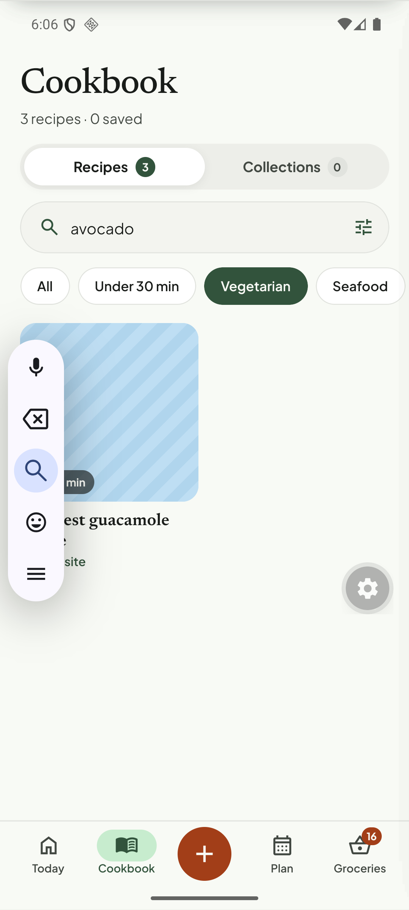

# Q15. Cookbook state, subtitle and plural

🟡 Low · mobile · Findings **F76, F70, F13**

## Problem

1. **Search text and filter chips persist after leaving the tab.** After searching "avocado" with *Vegetarian* on, switching to another tab and returning still shows "avocado" + *Vegetarian*. Freshly imported recipes (cake, pasta, pancakes) are hidden, so the user thinks the import failed.
2. Subtitle **"3 recipes · 0 saved"**: "saved" is ambiguous (favourites?). With one recipe it reads **"1 recipes"**.

## Evidence

## Root cause (verified)

* The query, chip and refine state live in a global zustand store `useCookbook` (`tortie/data/cookbook.ts`: `q`, `filter`, `rf`), which survives navigation by design. Nothing resets it on tab change or after a successful import.
* `tortie/screens/cookbook.tsx` l.~66: `` `${v.nAll} recipes · ${v.nSaved} saved` `` has a literal "recipes" and the unclear "saved".

## Fix

1. Reset `q` and `filter` when the Cookbook tab loses focus (or after 60 s), and always after an import completes. Keep `rf` (sort/refine) if the sheet shows an active-filter badge.
2. When filters/search are active and hide ≥ 1 recipe, show a visible **"Showing 1 of 4 · Clear"** row under the chips.
3. Subtitle: `plz(n, 'recipe')` (already exists in `tortie/lib/fmt.ts`), and rename "saved" to "favourites" (`♥ 2`) or drop it.

## Acceptance criteria

- Return to Cookbook after a tab switch: search empty, chip = All.
- With an active filter a "Showing x of y · Clear" row is visible.
- "1 recipe", "3 recipes · 2 favourites".

## Tests

- Jest: store reset on blur / after import; subtitle helper for 0, 1, n.
- Maestro: search → switch tab → return → `assertNotVisible` search text.
