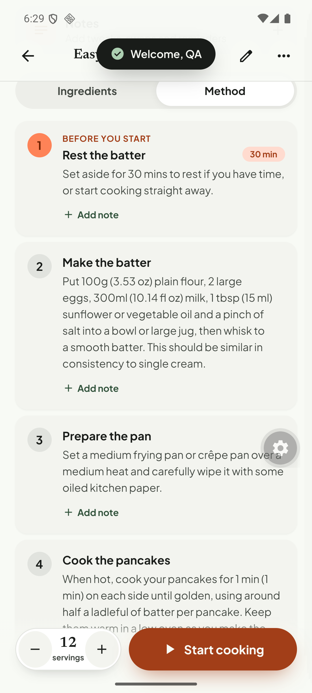
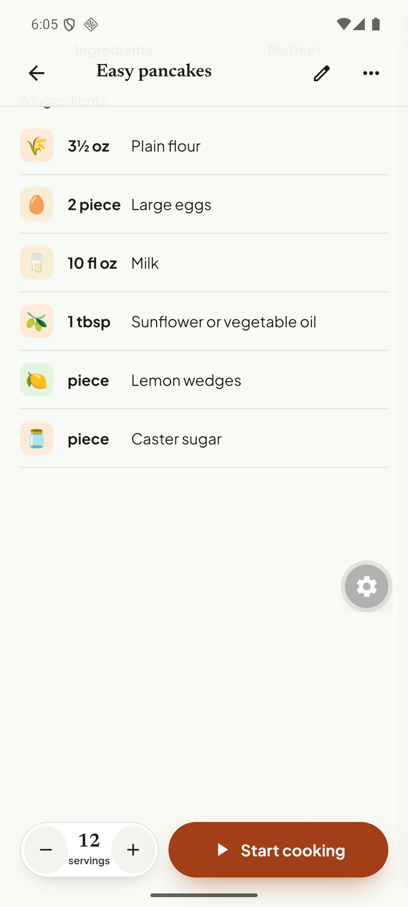
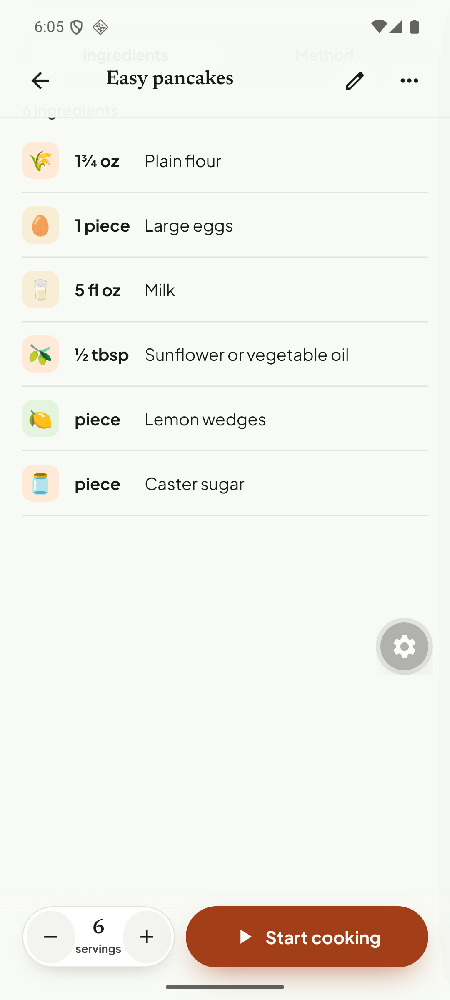
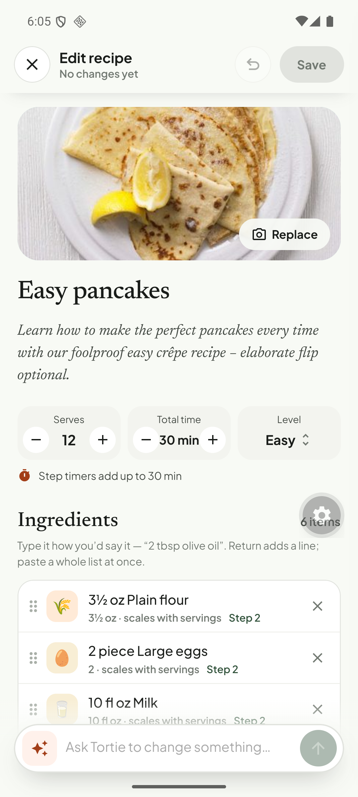
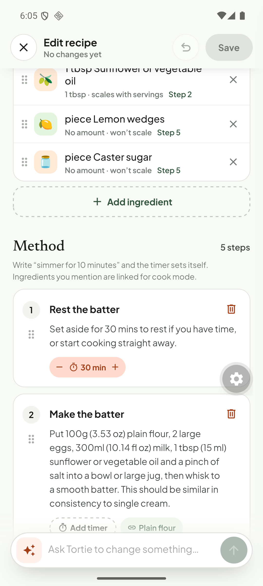

# Q16. Units and scaling in method text; the editor and the unit preference

🟠 Medium · mobile (+ API text generation) · Findings **F65, F66, F67**

## Problem

1. **Unit preference only partly applies to step text.** In Imperial mode the ingredient rows convert (`3½ oz`, `10 fl oz`, observed). The Method text is written as "Put **100g (3.53 oz)** plain flour, **300ml (10.14 fl oz)** milk" and, **from reading the code**, only temperature and length pairs are re-ordered for imperial users. *I did not capture the Method tab with Imperial on; confirm that first.*
2. **Servings scaling does not touch the method.** Scaling 12 → 6 servings halves the ingredient rows (observed: `1 piece Large eggs`, `1¾ oz Plain flour`). The code never applies the scale to step text, so step 2 keeps saying "2 large eggs … 100g plain flour" (not captured on screen).
3. **The editor shows ingredients converted to the user's unit preference** ("3½ oz Plain flour"), so a save may write converted values back over the stored metric source. (Needs a verification, see below.)

## Evidence

## Root cause

1. **Verified.** `preferUnits()` (`apps/mobile/src/features/recipes/units.ts`) swaps pair order using a regex whose `AMOUNT` part only matches **temperatures** (`°C/°F`), **lengths** (`cm`, `mm`, `in`). Mass/volume pairs (`g`, `ml`, `oz`, `fl oz`, `tbsp`) are never matched. The text itself is baked by the API's `addDualMeasurements()` (see [Q04](Q04-ingredient-fidelity-and-groups.md)).
2. **Verified.** `toTDetail` (`tortie/data/recipes.ts`) builds step `d` from `stepCopy(s, units)` and does not use the servings scale at all; only `ingQty(x, scale)` scales rows.
3. **Needs verification.** `useTRecipe` (editor path) calls `toTDetail(…, units)`; the editor's ingredient lines are `txt` strings built from the converted amounts.

## Fix

1. **Stop baking measurements into step text.** Store the instruction with *tokens* (`{{ing:0}}` or `{{qty:100 g}}`) or at least store both numbers structured: API returns `instruction` (as written) + `measurements: [{ start, end, metric, imperial }]`. The app renders the user's system and scales by the servings factor. This solves 1 and 2 together and removes the "(1 min) (1 min)" noise.
2. Interim, cheaper: extend `preferUnits` to mass/volume pairs (`\d+\s?(g|kg|ml|l|oz|lb|fl oz|tbsp|tsp|cup)`) and, when scaling ≠ 1, rewrite the *first* number of each matched pair by the factor (round with `fmtQ`). Skip text that has no pair.
3. **Editor:** always load the stored **as-written/metric** values, never the display-converted ones; show the unit conversion as a hint, not as editable text. Make the editor receive `useTRecipe(id, { units: 'source' })`.
4. When the user changes servings in the detail view, show a small note under the Method tab ("Amounts in the text are for 12 servings") until step 1 lands.

### Verify first (5 minutes)
Set **Imperial**, open *Edit recipe* on "Easy pancakes", change only the title, **Save**, then query `recipe_ingredients` for flour: if `metricQuantity` is no longer `100 g` (or `quantity` became `3.5 oz`), item 3 is a data-corruption bug and should be raised to 🔴.

## Acceptance criteria

- Imperial preference: no step text shows a metric amount first (except where no imperial exists).
- Changing servings changes the amounts in step text (or the clear note from item 4 is shown).
- Saving an unchanged recipe in the editor never changes stored quantities/units.

## Tests

- Jest: `preferUnits` table for g/ml/oz/tbsp/°C/cm; scaling of the first number in a pair; editor round-trip (`toEditorState(recipe, imperial)` → `toPatch` equals the original).
- API vitest if the structured-measurement approach is chosen.
