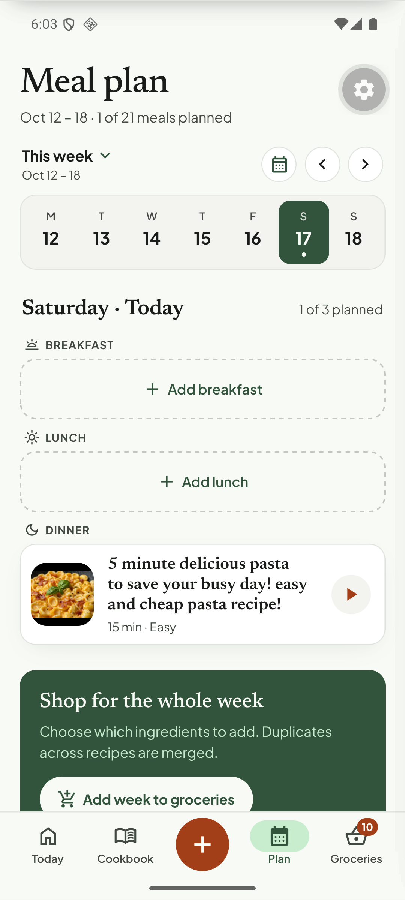
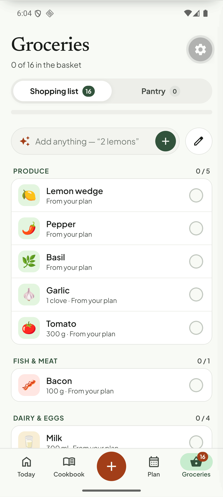
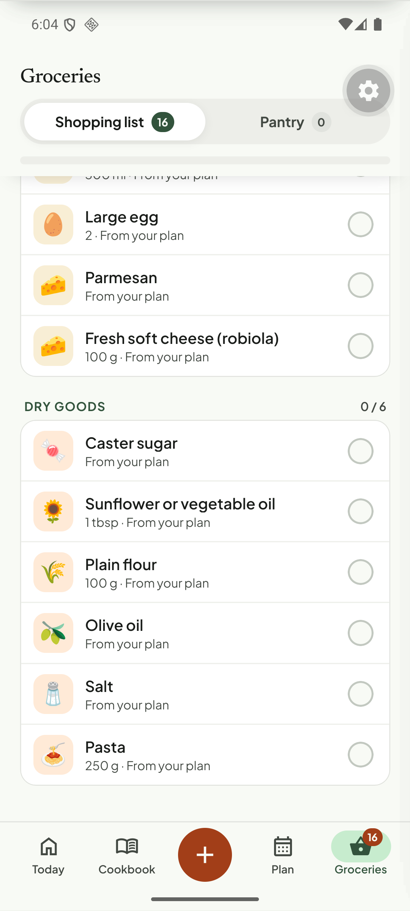
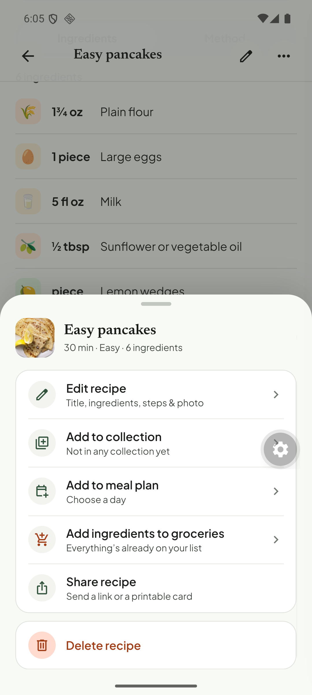
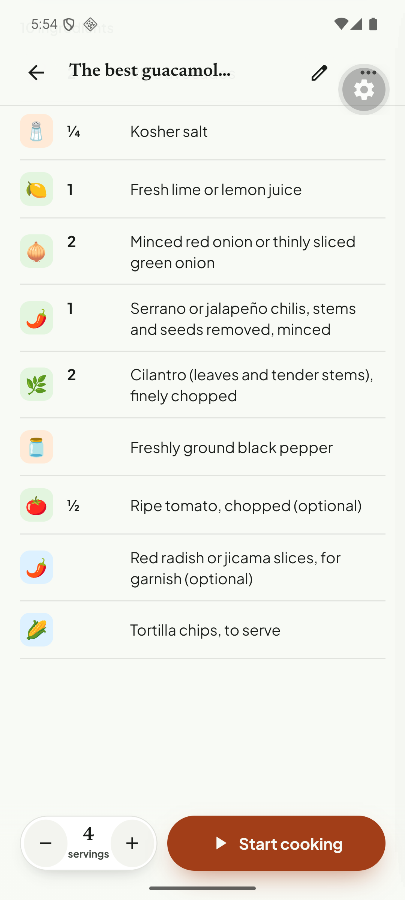

# Q17. Groceries: plan sync copy, emoji and aisle

🟠 Medium · mobile copy + small API/data · Findings **F58, F57, F59, F22**

## Problem

1. **The shopping list fills itself the moment a meal is planned**, while the UI says otherwise. After planning one dinner the Groceries tab badge showed **10**; after a second meal **16**, and every row says "From your plan". Yet:
   * the Plan screen card says *"Shop for the whole week — **Choose which ingredients to add**. Duplicates across recipes are merged."* with an **Add week to groceries** button;
   * the recipe menu says *"Add ingredients to groceries — **Everything's already on your list**"*.
   The user cannot tell whether the list is automatic or manual, and cannot opt out per recipe.
2. **Item quality:** black "Pepper" sits in PRODUCE with a chili-pepper emoji; "Red radish or jicama" gets a chili emoji; oils land in "Dry goods"; "Lemon wedges" becomes "Lemon wedge"; items with no amount show only "From your plan" (Salt, Olive oil, Parmesan).

## Evidence

## Root cause

1. **Verified, deliberate backend behaviour.** `apps/api/src/modules/meal-plan/application/meal-plan-service.ts` (~l.122) calls `shoppingListService.addFromRecipe(…, { source: ShoppingListSource.MEAL_PLAN, sourceMealPlanEntryId })` when an entry is created and `deleteByMealPlanEntry` when it is removed (~l.169). The mobile Plan card ("Add week to groceries", `plan.tsx` `addWeek`) and the groceries empty state ("fill from plan", `useGroceryActions.fillFromPlan` in `tortie/data/groceries.ts`) were designed for the *manual* flow and now duplicate it.
2. **Verified.** Emoji/aisle come from `presentation-heuristics.ts` (`categorizeIngredient`) on the API and `emoOf`/`lexOf` in `tortie/lib/fmt.ts` on the client; the client lexicon takes precedence over the API value (`recipes.ts`: `lexOf(x.name) ? e.emo : x.emoji …`). "Radish/jicama" matches a "chili/pepper" key; "pepper" has no spice rule.

## Fix

**Decide the product behaviour first** (owner decision):

* **A. Automatic (matches the backend):** keep the sync; remove the "Choose which ingredients to add"/"Add week to groceries" card (replace with "Your week's ingredients are on your list · Review"), change the recipe menu row to "On your list ✓" with a toggle to remove, and show a one-time toast "Added 10 ingredients to your groceries" when planning. Respect pantry items ("have" items are skipped: `partitionByPantry`).
* **B. Manual (matches the copy):** remove the `addFromRecipe` call from `meal-plan-service.ts` (keep `sourceMealPlanEntryId` for the manual add), and keep the Plan card as the way in.

Either way:

1. The badge on the Groceries tab must count **unchecked** items and change with a short animation so the user sees the cause.
2. Fix aisle/emoji rules: `black pepper`/`pepper` → Spices, `radish|jicama` → Produce with a root-vegetable emoji, `oil|vinegar` → Oils & condiments; do not singularise names that are part of a phrase ("lemon wedges").
3. Rows without an amount: show "to taste" / "as needed" instead of an empty amount, or just the note.
4. Prefer the API `emoji` when the recipe specified one; use the client lexicon only as a fallback.

## Acceptance criteria

- The Plan card, the recipe menu and the actual behaviour tell the same story (A or B).
- Black pepper is in Spices; radish has a radish/root emoji; oils are not "Dry goods".
- Planning, then removing the meal, removes exactly the rows it added (A).

## Tests

- API vitest for the chosen behaviour (`meal-plan-service` with/without sync).
- Jest for `categorizeIngredient`/emoji table (pepper, radish, oils, "lemon wedges").
- Maestro: plan a recipe → groceries count matches what the copy promises.
