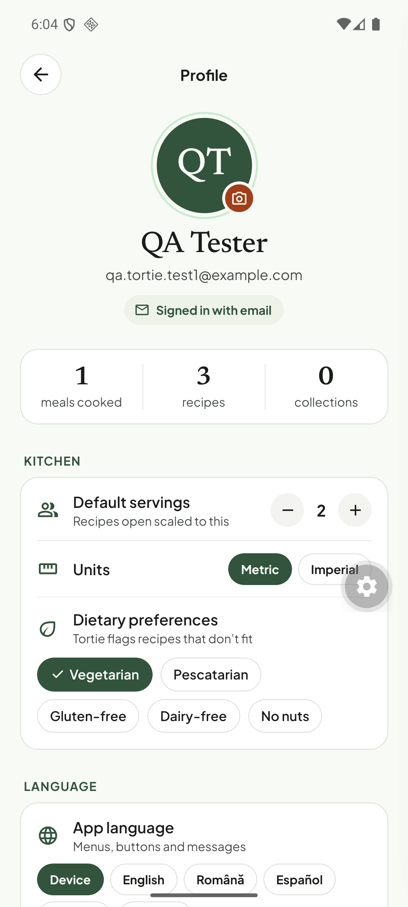
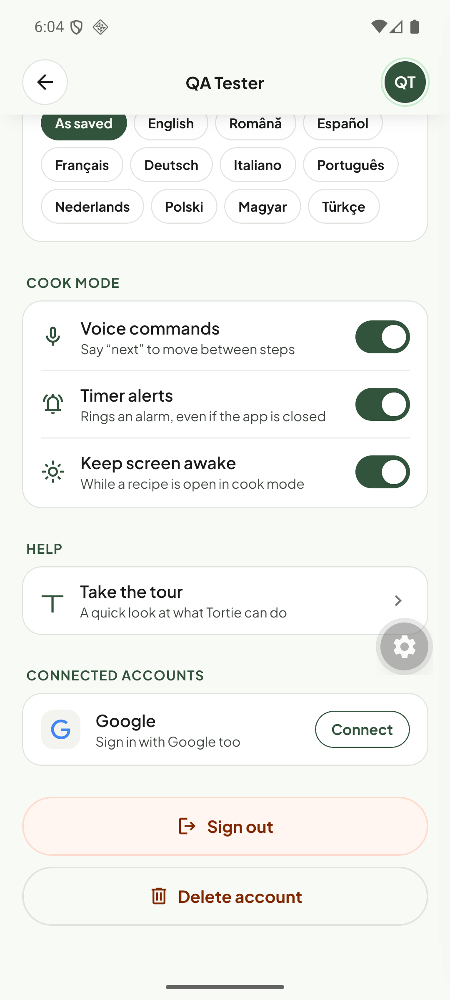

# Q18. Settings that do nothing; "Vegetarian" is on by default

🔴 High (trust) · mobile · Findings **F61, F62, F64**

## Problem

1. **"Default servings — Recipes open scaled to this"** (Profile → Kitchen) is saved but nothing reads it. Recipes open at their own servings (guacamole 4, pasta 2, pancakes 12).
2. **"Dietary preferences — Tortie flags recipes that don't fit"** is saved but nothing flags anything. The Cookbook "Vegetarian" chip is a separate, hard-coded filter.
3. **Every new account starts with "Vegetarian" switched on**, so a brand-new omnivore sees a vegetarian profile.
4. The Profile screen has no cooking history (known stub), no Terms/Privacy/About/version rows, no support link; "Voice commands" is ON by default with no permission prompt seen.

## Evidence

## Root cause (verified)

* `tortie/prefs-store.ts` defaults: `defaultServings: 2`, `diet: { veg: true }` (≈ l.35–38).
* A search of `apps/mobile/src` for `defaultServings` and `.diet` finds usages **only in `screens/profile.tsx`** (the controls) and the store. No recipe, cookbook, cook-mode or plan code consumes them.

## Fix

Pick per setting (owner decision):

**Default servings**
* Use it: the servings stepper on recipe detail starts at `defaultServings` and the amounts scale from the recipe's base servings (needs Q16 for step text). Show "Scaled for 2 · original 12".
* Or remove the row until it is implemented.

**Dietary preferences**
* Use it: a recipe is flagged when its ingredients contain a forbidden class (meat/fish/gluten/dairy/nuts). The API has `canonicalName` + categories ("Fish & meat", "Dairy & eggs"); add a `dietFlags` computation (API-side `recipe-presentation.ts`, cached on the recipe) and show a small chip on the card/detail ("Contains meat") and optionally a Cookbook toggle "Hide recipes that don't fit".
* Default: **no preference selected**. Run a one-time question in onboarding if wanted.
* Or remove the row until it is implemented.

**Profile hygiene**
* Add About → version, Terms, Privacy (the sign-in screen already links them), Support.
* Request the microphone permission when the user first enables Voice commands, and default it OFF until granted.

## Acceptance criteria

- No toggle/stepper in Settings is a no-op (grep: every `prefs.*` key has at least one consumer outside `profile.tsx`, covered by a test).
- New account: no diet selected.
- Setting default servings to 4 makes a 2-serving recipe open at 4 with scaled amounts (if implemented).
- A vegetarian user sees "Contains meat" on the bacon pasta (if implemented).

## Tests

- Jest: guard test that scans `prefs-store.ts` keys and fails if a key is referenced only in the profile screen.
- API vitest for `dietFlags` on fixtures (bacon pasta: meat; pancakes: dairy/gluten; guacamole: none).
