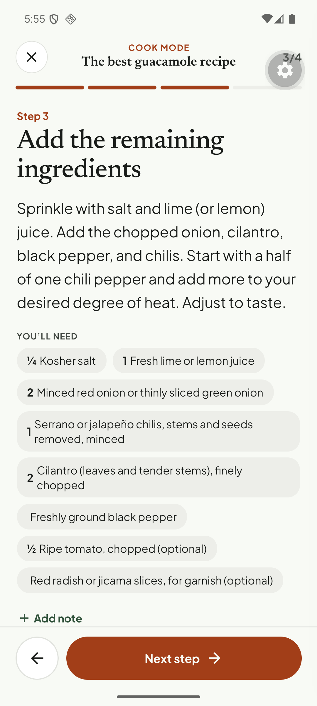
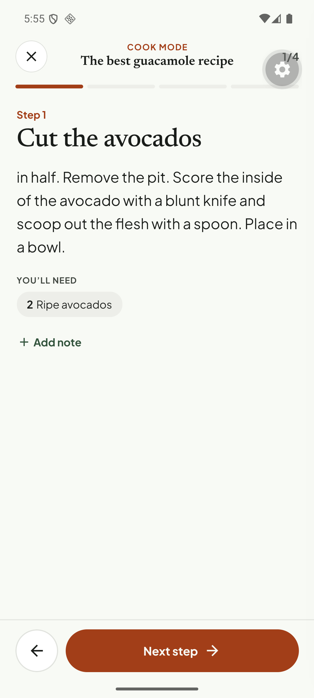
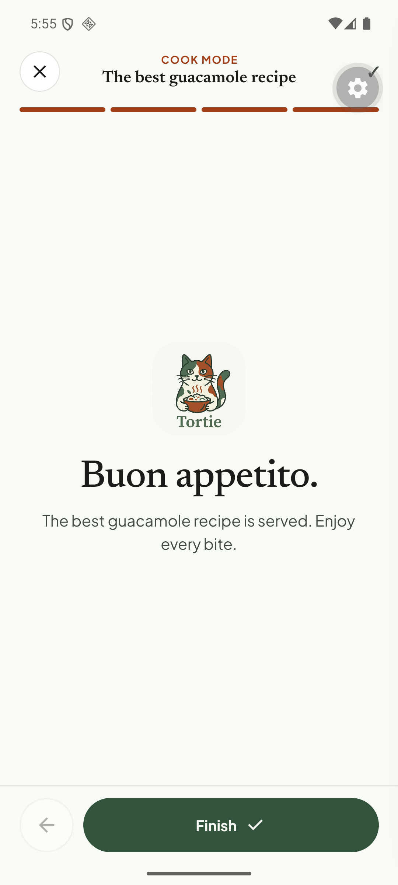
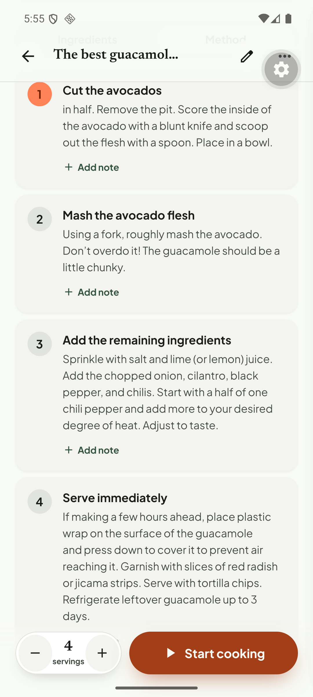

# Q19. Detail, editor and cook-mode polish

🟡 Low · mobile · Findings **F23, F68, F30, F28, F29, F31, F32, F01, F10**

A bundle of small visual/copy issues. Each item is independent; tick them one by one.

- [ ] **F23. Translucent sticky header.** When the recipe detail scrolls, the faint list text ("6 ingredients", ingredient rows) bleeds through the sticky title bar. Make the collapsed header opaque (`C.bg`) or add a proper blur.
  
- [ ] **F68. Editor "Total time" stepper.** The − / + buttons touch the "30 min" value. Give the value a min width or shrink the buttons.
  
- [ ] **F30. Cook step "You'll need" chips.** Chips with a quantity and chips without one are indented/aligned differently, and the quantity chips lack units when [Q01](Q01-ingredient-units-and-ranges.md) is not fixed.
  
- [ ] **F28. "portions" vs "servings".** Cook overview says "portions"; the detail page says "servings". Use one word (servings).
  
- [ ] **F29. Empty area under the cook step.** Step content sits at the top with a large empty area and no timer/temperature row for steps that have none. Centre or add the "mark ingredient used" affordance there.
  
- [ ] **F31. "Buon appetito." for every cuisine.** Pick copy by cuisine (`recipe.cuisine`) or use neutral "Enjoy your meal." Keep the Italian line for Italian recipes.
  
- [ ] **F32. Finishing cook mode returns to the recipe with no feedback.** Add a completion sheet: rating (1–5), optional note, "Add to cooked history". Profile "1 meals cooked" needs a history screen to point at (`todo.md` "Cook history screen").
  
- [ ] **F01. Sign-up step 2 email pill wrap** (covered in [Q13](Q13-signin-success-screen.md)).
- [ ] **F10. Plan empty state: cropped "R" on a decorative back card.** Check the `EmptyArt` back-card crop in `ui/empty-state.tsx` ⚠ WIP; clip the glyph inside the card bounds or remove the letter.
  

## Acceptance criteria

Each item verified by screenshot on a Pixel 6 and a 360 dp phone; no new visual regressions on the other detail/cook screens.

## Tests

Mostly visual. Add Maestro screenshots (`takeScreenshot`) for the detail header, the editor time row and the cook overview so future changes can be compared.
