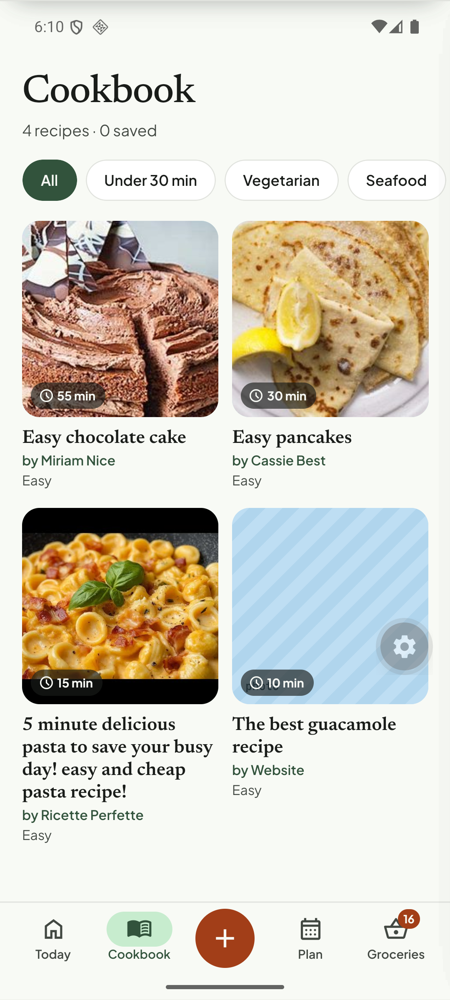
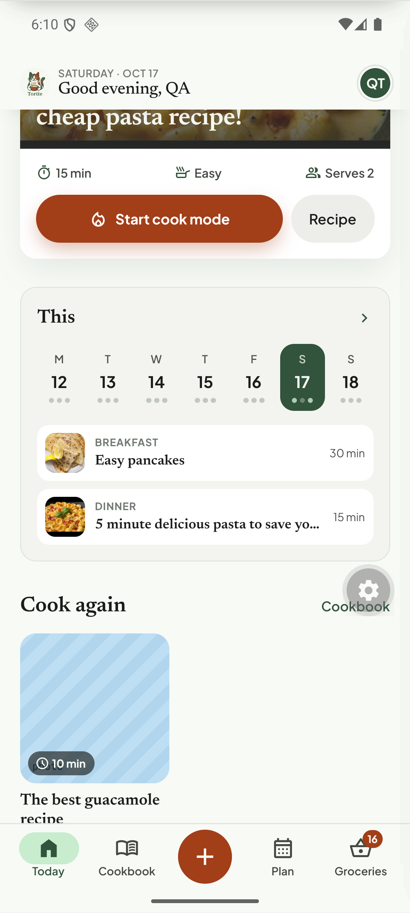

# Q21. Dark mode: implement it or lock to light

🟡 Low · mobile · Finding **F77**

## Problem

`apps/mobile/app.json` declares `"userInterfaceStyle": "automatic"`, but with the device in dark mode the app stays light. The status bar/system UI follow the dark setting while the app content is light, which can produce unreadable status-bar icons on some screens.

## Evidence

Device in dark mode (`adb shell cmd uimode night yes`):

## Root cause

The Tortie theme (`tortie/theme.ts`, `COLOR_SCHEMA.md`) defines one light palette `C.*`; there is no dark palette or `useColorScheme()` switch.

## Fix (owner decision)

* **Quick:** set `"userInterfaceStyle": "light"` in `app.json` (and the `expo-system-ui` `backgroundColor`), keep the status bar style `dark`. Document "light only for v1".
* **Full:** introduce a dark palette (`COLOR_SCHEMA.md` first), make `C` a hook (`useTheme()`), and migrate the screens. Large; plan it as its own epic.

## Acceptance criteria

- Quick option: in system dark mode the status bar icons stay legible on every screen; nothing is half-dark.
- Full option: every screen in the test pass renders in both palettes with sufficient contrast.

## Tests

Manual screenshot pass in both modes; for the quick option a Maestro step toggling `adb shell cmd uimode night yes` and asserting the Today screen.
