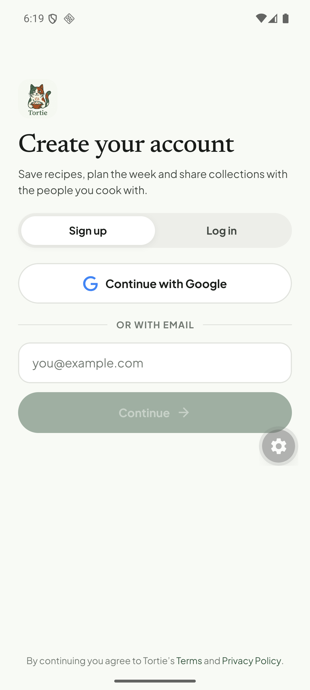
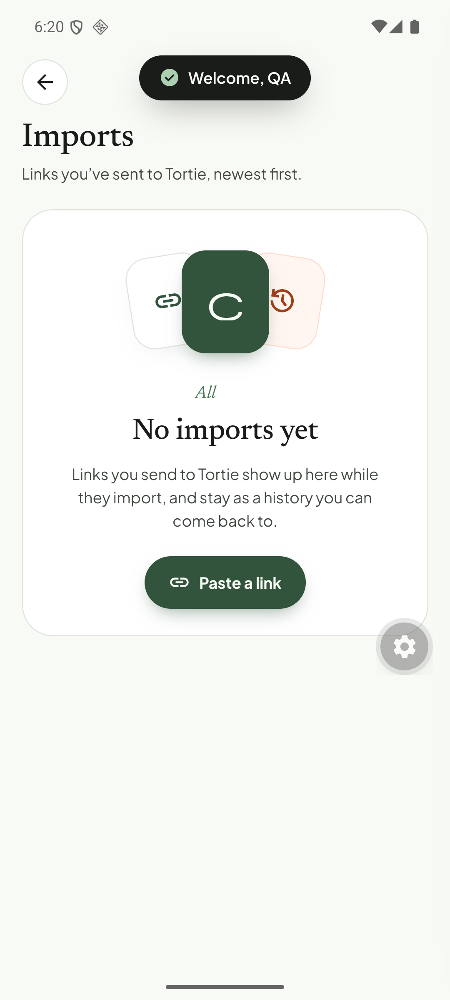

# Q22. Auth and session: sign-out screen, imports ledger, API URL

🟠 Medium · mobile · Findings **F78**, plus two related observations (imports ledger, `.env` LAN address)

## Problem

1. **Sign out → blank Profile.** After tapping **Sign out**, the Profile screen showed only its header ("QA Tester" and the avatar) with an **empty body** for several seconds, instead of going straight to the sign-in screen. (The emulator froze right after, so this needs a re-check on a clean run.)
2. **Imports history disappears after sign-out/sign-in.** After logging back in, *Imports* says **"No imports yet"** although the server holds 10 import jobs for this user (4 completed, 6 failed).
3. **The API URL is a LAN address in `.env`** (`EXPO_PUBLIC_API_URL=http://192.168.88.28:3000/api/v1`). It breaks on any other network and for teammates; a reverse-tunnel (`adb reverse`) was needed for the emulator test.

## Evidence

(Screenshot of the blank Profile body was not kept; it showed the "QA Tester" header over an empty page.)

## Root cause

1. **Hypothesis.** `reset-user-data.ts` (`features/auth`) clears the local stores and query caches *before* the Firebase `onAuthStateChanged` event swaps the gate to the sign-in screen. The Profile screen re-renders with empty data and no user for a moment (all its sections are conditional on `user`). **Repro:** sign out five times on a physical device and record the screen; check the order in `use-auth-listener.ts` / `reset-user-data.ts` (both modified in the working tree).
2. **Verified.** The import ledger is the local zustand store `useImports` (`tortie/import-store.ts`, key `tortie-imports`, persisted with AsyncStorage, `partialize` keeps only finished jobs). `reset-user-data` wipes it on sign-out and it is never rebuilt from the server. The API only exposes `GET /recipes/extract/jobs/:id` and `/cancel` (`apps/api/src/modules/jobs/api/jobs.routes.ts`); there is **no list endpoint**.
3. **Verified.** `apps/mobile/.env` hard-codes the LAN IP; `app.config.ts` does not fall back to a dev-host derived value.

## Fix

1. Navigate to the sign-in screen first (set `auth.status = 'signingOut'` and render the sign-in route), then clear the data. Show a short "Signing out…" state, never a half-empty Profile.
2. Hydrate the ledger from the server on sign-in: add `GET /recipes/extract/jobs?limit=20` (scoped to `requestedByUserId`, which is already stored on `extraction_jobs`) and merge by `serverJobId`; keep failed jobs with the localised error copy ([Q08](Q08-supported-sources-and-error-copy.md)). Alternatively rename the screen "Recent imports (this device)" if device-local is intended.
3. `.env.example`: use `http://10.0.2.2:3000/api/v1` (emulator) as the documented default and add a README line for `adb reverse tcp:3000 tcp:3000`; derive the host from `Constants.expoConfig.hostUri` in dev so a physical device on the same Wi-Fi works without editing `.env`.

## Acceptance criteria

- Sign-out goes directly from Profile to the sign-in screen (video/screenshot sequence).
- After sign-in the Imports screen lists the user's recent jobs (or the screen is clearly labelled device-local).
- A new teammate can run the app on an emulator with only `cp .env.example .env`.

## Tests

- Jest: sign-out ordering (mock Firebase: assert the route changes before the stores reset); ledger hydration merge (dedupe by `serverJobId`).
- Maestro: sign out → `assertVisible: "Log in"`; sign in → Imports lists ≥ 1 row.
